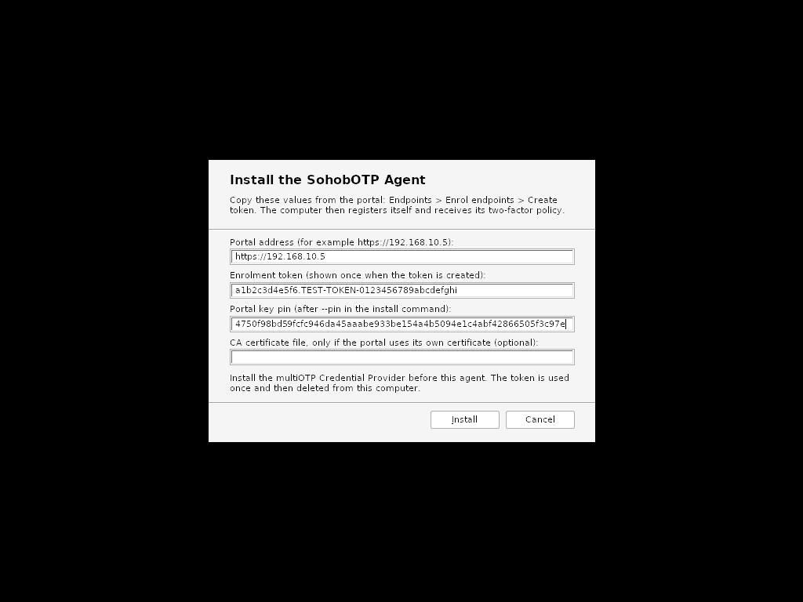

# SohobOTP agent

The agent runs on each managed Linux or Windows machine. It enrols once with a token, then
checks in with the SohobOTP portal over HTTPS, applies the signed configuration of its
endpoint group, and reports inventory and the result. Protocol:
[portal/docs/agent-protocol.md](../portal/docs/agent-protocol.md); design:
[portal/docs/endpoints.md](../portal/docs/endpoints.md).

## Install

Create an enrolment token on the portal's **Enrol endpoints** page; it shows the commands.

```sh
# Linux, as root
sohobotp-agent install --portal https://portal.example.com --token <TOKEN> --pin <PIN>
```

```powershell
# Windows, administrator PowerShell (install SohobOTP Sign-in (SohobOTPSignIn.msi) first)
.\sohobotp-agent.exe install --portal https://portal.example.com --token <TOKEN> --pin <PIN>
```

Add `--ca-file ca.pem` when the portal certificate is not publicly trusted (the appliance's
self-signed one). Verification is never switched off.

**Windows, by hand:** double-click `sohobotp-agent.msi` (as an administrator). The setup window
asks for the portal address, the enrolment token, the pin and, if the portal uses its own
certificate, the CA file; **Install** stays disabled until the first three are filled in.
Install SohobOTP Sign-in first.



**Group Policy (Windows):** deploy `sohobotp-agent.msi` silently (Computer Configuration →
Software Installation, with a transform setting the properties, or a startup script); silent
installs skip the windows:

```powershell
msiexec /i sohobotp-agent.msi /qn PORTAL=https://portal.example.com TOKEN=<TOKEN> PIN=<PIN> [CAFILE=C:\path\ca.pem]
```

The MSI installs the agent and the `SohobOTPAgent` service and writes PORTAL, PIN and CAFILE
to `HKLM\SOFTWARE\SohobOTP\Agent`. The token is **not** written there (every user can read
that key, and Windows Installer logs registry values): a custom action hidden from the log
runs `sohobotp-agent.exe save-token`, which keeps it in the agent's state folder (SYSTEM and
Administrators only). The service enrols on its first start and **deletes the token**. Use an enrolment token with *Active Directory
approval*: anyone can read a GPO's files, so a copied token must not admit unknown machines.
Build: `sh agent/packaging/windows/build-msi.sh` (msitools in Docker; the installer windows
are tables in `packaging/windows/ui/` added with msibuild). `check-msi-ui.sh` shows them under
Wine and takes screenshots. **Upgrades**: a newer MSI (`AGENT_VERSION=x.y.z`, the version
must grow) installed over an older one, by hand or by Group Policy, replaces it in place and
keeps the machine's identity; an older MSI over a newer one is refused (tables added by
build-msi.sh, see `packaging/windows/tables/README.md`). Self-update works as well.

Other commands: `status`, `run --once` (check in now), `apply --dry-run --config FILE`
(Linux: show what a policy would change), `uninstall`, `version`.

## What it changes

**Linux** (PAM → RADIUS, `libpam-radius-auth` / `pam_radius`, installed if missing):

| File | Content |
|---|---|
| `/etc/pam.d/sshd`, `sudo`, `login`, `su` (as the policy says) | two lines added after the password step: a marker and `auth include sohobotp-2fa`. On RHEL an `auth include system-auth` step becomes `auth substack system-auth` (its `sufficient pam_unix` would otherwise end the stack before the code); the original line is kept in the marker and restored |
| `/etc/pam.d/sohobotp-2fa` | exclusions (root always; users; groups) that skip **only** the code, then `pam_radius_auth.so ... prompt=code force_prompt` |
| `/etc/pam_radius_auth.conf` (Debian/Ubuntu), `/etc/pam_radius.conf` (RHEL/Rocky 9) or `/etc/raddb/server` (older RHEL) | RADIUS servers and this machine's own secret, root 0600; a pre-existing file is kept as `.sohobotp-orig` |
| `/etc/ssh/sshd_config.d/00-sohobotp.conf` (sorts first: sshd keeps the first value, and RHEL's `50-redhat.conf` turns keyboard-interactive off) | `KbdInteractiveAuthentication yes`, `PasswordAuthentication no` (passwords go through PAM so the code is asked), optional `AuthenticationMethods publickey,keyboard-interactive` |

Every apply is snapshotted; any failure (including `sshd -t`) restores all files. Turning
2FA off in the portal restores the files byte for byte.

**Windows**: the registry values of SohobOTP Sign-in (Sohobcom fork of the multiOTP Credential Provider)
(`HKCR\CLSID\{B3D2C6A1-5E7F-4C21-9A6E-0D4F5C8B7A31}`): the machine's own gateway URL
(`portal/cp.php?e=<id>`) and secret, sign-in / unlock / UAC modes, break-glass account,
offline cache and texts. Existing value types are kept; the agent refuses to run without
the Credential Provider; failures restore the previous values.

## Files and service

| | Linux | Windows |
|---|---|---|
| State and keys | `/etc/sohobotp-agent/` (0700, files 0600) | `%ProgramData%\SohobOTP\agent\` (SYSTEM and Administrators only) |
| Binary | `/usr/local/sbin/sohobotp-agent` | `%ProgramFiles%\SohobOTP\Agent\sohobotp-agent.exe` |
| Service | `sohobotp-agent.service` (systemd, restart always) | `SohobOTPAgent` ("SohobOTP Agent", automatic, restart on failure) |
| Log | journal (`journalctl -u sohobotp-agent`) | `agent.log` in the state folder |

## Security choices

- The portal key is pinned at install (`--pin`); configurations signed by another key, for
  another endpoint or OS, or not newer than the applied version are never applied.
- Each request is signed with the machine's Ed25519 key (time + nonce, no replay); secrets
  in configurations are sealed to its X25519 key. Private keys never leave the machine.
- When the portal is unreachable, refuses the machine (disabled) or keeps it pending, the
  last applied configuration stays: 2FA is never removed by a failure.
- Windows private keys are encrypted with DPAPI (machine scope) inside a folder readable by
  SYSTEM and Administrators only: a copied state file is useless on another machine.
- Self-update (below) only installs releases signed with the offline release key built into
  the agent, never older versions, and only if size and SHA-256 match.

## Self-update (signed releases)

1. Once, on an offline machine: `sohobotp-agent release keygen --out /secure/folder`. Keep
   `release-private.key` there; build agents with the printed public key:
   `AGENT_VERSION=x.y.z RELEASE_PUBLIC_KEY=<key> sh agent/tests/run-in-docker.sh`.
2. For each release and platform: `sohobotp-agent release sign --key release-private.key
   --file sohobotp-agent-linux-amd64 --version x.y.z --os linux --arch amd64 --out manifest.json`.
3. On the portal: `portal-admin.php agent-release-add --file=... --manifest=...`
   (set `MULTIOTP_PORTAL_RELEASE_KEY` to the public key so the portal also refuses bad uploads).
4. Choose the version as the endpoint group's **Agent version**. Older agents download it
   through the signed agent API and verify it, then:
   - **self-test**: the new binary is run once (`selftest --expect-version x.y.z`: right
     version, opens this agent's keys); a release that does not start is never installed;
   - the running binary is kept as `<binary>.previous`, the new one takes its place, and the
     agent restarts (systemd `Restart=always`; Windows recovery actions);
   - **roll back**: if the new version stops 3 times before its first successful check-in, it
     puts `.previous` back and exits, so the old version runs again; that version is then
     never installed again on this machine (`status`: "Update blocked"; publish a fixed
     version with a new number). The first successful check-in confirms the update.
   A refused release is retried after an hour at the earliest; the reason is in `status`.

## Tests

```sh
sh agent/tests/run-in-docker.sh   # gofmt, go vet (Linux + Windows), race tests, builds into agent/dist/
sh agent/tests/e2e-linux.sh       # production image + Debian endpoint, real FreeRADIUS and SSH
```

The end-to-end test (43 checks; `DISTRO=rocky` runs it on Rocky Linux 9) covers:
- enrolment (wrong pin refused, TLS with a test CA);
- password + code over SSH and sudo, wrong code, wrong password, a real SSH session;
- excluded user, break-glass group, root;
- RADIUS down (only users needing a code refused) and back;
- a policy change from the portal (sudo restored byte for byte), 2FA off (all files restored);
- self-update: a release signed with another key refused, a signed one installed and
  reported, the updated agent still enforcing the policy; a signed release that does not
  start refused by the self-test; a release that crashes after starting rolled back by
  itself after 3 starts and not installed again;
- uninstall.

Unit tests reproduce every libsodium protocol vector and cover the PAM and registry appliers
(rollback, refusals, RHEL layout).

## Windows: automatic test on real Windows, then the manual test

`.github/workflows/windows.yml` (in a **private** GitHub repository) compiles SohobOTP Sign-in
on Windows and, on a Windows Server 2022 machine, runs the agent's Go tests (real registry,
DPAPI) and `tests/windows/e2e.ps1`: both MSIs installed silently, enrolment against
`tests/fakeportal`, the registry values and their types, the token never in the registry or
the installer log and deleted after enrolment, DPAPI keys, the state folder ACL, service
recovery, uninstall (36 checks). `e2e.ps1` also runs by hand on a test machine.

What it cannot do is sign in at the Windows sign-in screen. Before production, on a
Windows 11 / Server 2022 test machine:

1. Install SohobOTP Sign-in (SohobOTPSignIn.msi), then the agent with a token.
   `sohobotp-agent.exe status` shows version 1 applied; the portal shows the inventory.
2. `reg query "HKCR\CLSID\{B3D2C6A1-5E7F-4C21-9A6E-0D4F5C8B7A31}"`: `multiOTPServers`
   is the `cp.php?e=` URL, the secret is not `ClientServerSecret`, types are unchanged.
3. Sign in (console and RDP) with password + code; wrong code refused; break-glass account
   needs no code; unlock and UAC follow the group's modes.
4. Offline: unplug the network after one successful login; the cached login works if the
   group allows the offline cache, and stops after the lifetime.
5. Change the group in the portal; after `run --once` (or 60 s) the new values are in the
   registry. Disable the endpoint; sign-in through the gateway is refused.
6. `services.msc`: SohobOTP Agent running, restarts after being killed; `uninstall` removes
   it.
7. MSI by double-click: the setup window, Install disabled until filled, the finish window,
   and `msiexec /i ... /l*v log.txt` does not contain the token (MsiHiddenProperties and the
   hidden SaveToken action; Wine ignores them, Windows does not). Silently: `msiexec /i sohobotp-agent.msi /qn PORTAL=...
   TOKEN=... PIN=...` enrols on its own;
   `HKLM\SOFTWARE\SohobOTP\Agent` never has `Token`, and `enrol-token` is gone from
   `C:\ProgramData\SohobOTP\agent` afterwards; the key fields in
   `agent.json` start with `dpapi:`.
8. Self-update: set a newer signed version as the group's target; the service restarts on it.

## Not done yet

- Windows: signing in with password + code at the sign-in screen (manual test above); the
  rest is tested automatically on Windows Server 2022.
- Roll back after a self-update is tested on Linux end to end; on Windows its code is the
  same and unit-tested, the MSI upgrade itself is tested on Windows Server 2022.
