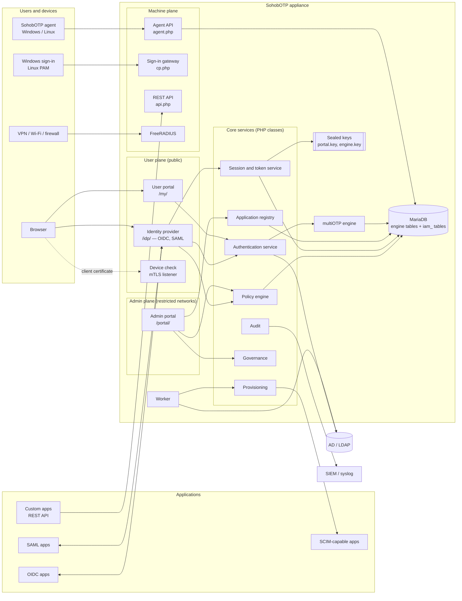
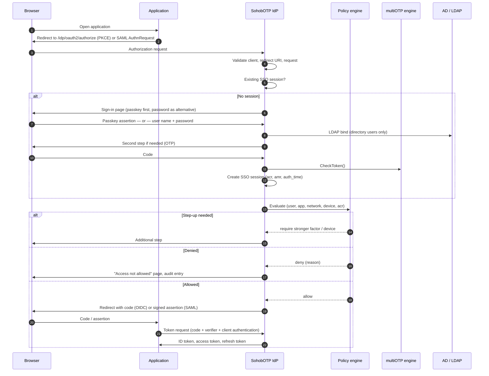
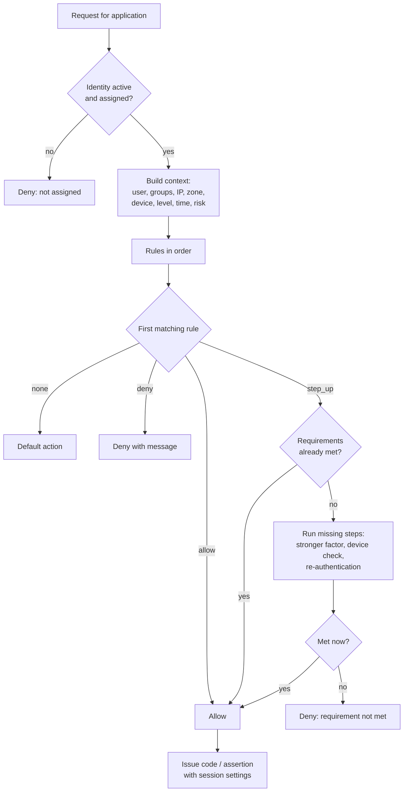
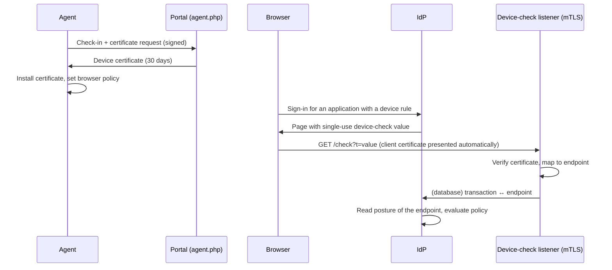
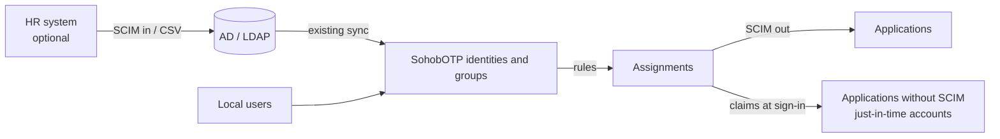
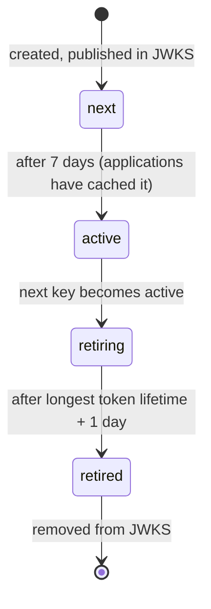
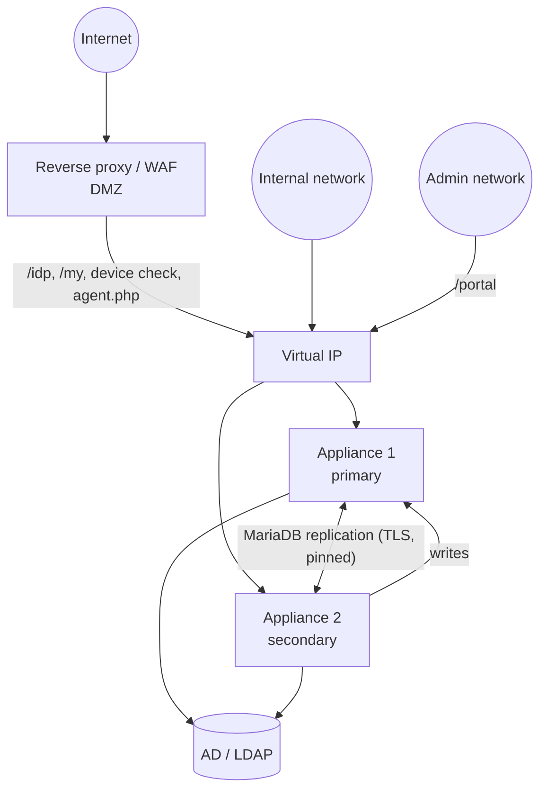
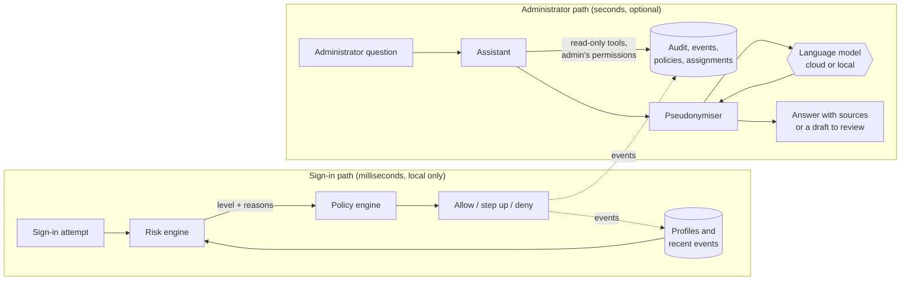

# SohobOTP IAM — architecture

Status: **proposal** (nothing in this document is built yet). Written 2026-11-16.

This document describes how SohobOTP grows from an MFA server with an endpoint agent into an
identity and access management (IAM) product: single sign-on for applications, phishing-resistant
sign-in, access rules that use the state of the user's computer, account provisioning, and
access governance.

It builds on what exists today (see [../README.md](../README.md), [endpoints.md](endpoints.md),
[agent-protocol.md](agent-protocol.md)) and names the classes, files, tables and endpoints to add.

## Contents

1. [Goals and scope](#1-goals-and-scope)
2. [What exists today](#2-what-exists-today)
3. [Target architecture](#3-target-architecture)
4. [Components](#4-components)
5. [Storage](#5-storage)
6. [Authentication](#6-authentication)
7. [Sessions and tokens](#7-sessions-and-tokens)
8. [OpenID Connect and OAuth 2](#8-openid-connect-and-oauth-2)
9. [SAML 2.0](#9-saml-20)
10. [Access policy (conditional access)](#10-access-policy-conditional-access)
11. [Device trust](#11-device-trust)
12. [Applications, assignments and claims](#12-applications-assignments-and-claims)
13. [Provisioning and account lifecycle](#13-provisioning-and-account-lifecycle)
14. [User portal and self-service](#14-user-portal-and-self-service)
15. [Governance](#15-governance)
16. [Administration and delegation](#16-administration-and-delegation)
17. [Keys and secrets](#17-keys-and-secrets)
18. [Audit, logging and monitoring](#18-audit-logging-and-monitoring)
19. [Deployment, HA and sizing](#19-deployment-ha-and-sizing)
20. [Threat model](#20-threat-model)
21. [Dependencies and build decisions](#21-dependencies-and-build-decisions)
22. [Testing](#22-testing)
23. [Roadmap](#23-roadmap)
24. [Open decisions](#24-open-decisions)
25. [Standards](#25-standards)
26. [AI features](#26-ai-features)

---

## 1. Goals and scope

### Positioning

**Workforce IAM with built-in device trust, for small and mid-size organisations**, delivered as
one appliance (or one Docker image). The differentiator is the agent: SohobOTP already knows
which computers are enrolled, healthy and tamper-protected, so access to an application can
depend on the computer as well as on the user.

### Goals

| # | Goal |
|---|---|
| G1 | One sign-in for all applications: SohobOTP is the identity provider (IdP) over OpenID Connect and SAML 2.0. |
| G2 | Phishing-resistant sign-in with passkeys (WebAuthn); OTP stays as the fallback. |
| G3 | Access rules per application: who, from where, on which computer, with which sign-in strength. |
| G4 | Accounts in applications are created, changed and disabled automatically (SCIM 2.0), driven by AD/LDAP. |
| G5 | Users help themselves: own authenticators, passkeys, password reset, list of their applications and sessions. |
| G6 | Governance: access requests with approval, periodic access reviews, reports. |
| G7 | Keep everything that works today (RADIUS, Windows sign-in, Linux PAM, REST API, HA) unchanged. |

### Not in scope

- Customer IAM (millions of consumer accounts, social login, self-registration).
- Privileged access management (password vault, session recording).
- Replacing Active Directory. AD/LDAP stays the source of truth for people and groups where it
  exists; SohobOTP adds local users for organisations without a directory.
- Acting as a *relying party* to other identity providers (federation inbound) — possible later,
  listed in [Open decisions](#24-open-decisions).

### Design principles

1. **Same security conventions as the portal**: CSRF on every POST, a permission on every page,
   an audit entry for every state change, output escaped with `e()`, secrets from
   `random_bytes()`.
2. **Do not write protocol cryptography by hand.** Token signing, XML signatures and WebAuthn
   verification come from maintained libraries (section 21).
3. **Secure defaults, few switches.** Authorization code with PKCE only; no implicit flow, no
   password grant; signed SAML assertions always.
4. **Fail closed.** If policy cannot be evaluated (database down, device state unknown) access
   is refused, with a clear message.
5. **The IdP is the most valuable target in the network.** Admin plane and user plane are
   separated; signing keys are sealed; every release is tested against the conformance suites.
6. **Engine stays the engine.** multiOTP keeps users, tokens and OTP checking. The IAM layer
   lives in the portal (`Portal\Iam\…`) and never changes engine files, so the LGPL boundary
   stays clear.

---

## 2. What exists today

| Area | Today | Where |
|---|---|---|
| Users | Synced from AD/LDAP or local; stored by the engine in files or MariaDB | `Users`, `Directory`, `MultiotpService` |
| Second factor | TOTP/HOTP, hardware tokens, recovery codes; lockout and replay protection in the engine | `Tokens`, engine `CheckToken()` |
| RADIUS | FreeRADIUS clients and server groups | `Radius`, `RadiusClient` |
| Endpoints | Go agent on Windows and Linux: enrolment, signed configuration, inventory, check-in, events, tamper protection, self-update | `Endpoints`, `AgentApi`, `agent/` |
| Windows sign-in | SohobOTP Sign-in (credential provider) through a per-computer gateway | `CpGateway`, `portal/cp.php` |
| Self-service | "Set up my code" after a directory-password check | `SelfEnrol`, `portal/enrol.php` |
| REST API | API keys with scopes; `POST /v1/auth/check` | `Api`, `ApiKeys`, `portal/api.php` |
| Admin plane | Named administrators, four roles, admin MFA, hardened sessions | `AdminRepository`, `Roles`, `Session`, `Mfa` |
| Audit | Hash-chained `audit.jsonl`, secrets redacted by key name | `Audit` |
| Jobs | File-based queue and one worker | `Jobs`, `bin/worker.php` |
| HA | Two appliances, MariaDB replication, RADIUS configuration copied every minute | `Ha`, `portal/ha.php` |
| Crypto | libsodium secretbox with `portal.key`; Ed25519 portal signing key; X25519 sealing to agents | `Crypto`, `EngineKey` |

### Gaps to close

| Gap | Why it matters for IAM |
|---|---|
| No SSO protocols | Applications cannot delegate sign-in to SohobOTP. |
| No end-user session | Users only meet SohobOTP at an OTP prompt; there is no browser session to reuse across applications. |
| No first factor owned by SohobOTP | Passwords are checked by AD or by the client (Windows, VPN). The IdP must check the first factor itself (LDAP bind, local password or passkey). |
| Portal data in JSON files | `endpoints.json`, `admins.json`, jobs and throttling are files on one appliance. They are not replicated by the HA pair, and they do not fit sessions, tokens and grants (many small writes, expiry, lookups by several keys). |
| No Composer dependencies | The portal has no third-party PHP code today. Protocol libraries need a dependency policy (section 21). |
| No application or entitlement model | Nothing says "user X may use application Y with role Z". |
| Agents that go silent are only shown as "offline" | A device-trust decision needs a clear, time-bounded device state. |

---

## 3. Target architecture

### Three planes

| Plane | Who uses it | Entry points | Exposure |
|---|---|---|---|
| **User plane** | Every employee, from anywhere | `/idp/…`, `/my/…`, device-check listener | Internet (needed for SaaS applications) |
| **Admin plane** | Administrators, helpdesk, auditors | `/portal/…` | Admin networks only (nginx `allow`/`deny`, configurable in the portal) |
| **Machine plane** | Agents, credential providers, RADIUS clients, API callers, HA peer | `agent.php`, `cp.php`, `api.php`, `ha.php`, UDP 1812/1813 | Internal networks; agents may need Internet for roaming laptops |

The split is the main structural change. Today everything public is under `/portal/`. With an
IdP reachable from the Internet, the admin sign-in page must not be reachable the same way.

### URL layout

| Path | Purpose | Front controller |
|---|---|---|
| `/idp/.well-known/openid-configuration` | OIDC discovery | `portal/idp.php` |
| `/idp/oauth2/authorize`, `/token`, `/userinfo`, `/jwks`, `/revoke`, `/introspect`, `/logout` | OIDC / OAuth 2 | `portal/idp.php` |
| `/idp/saml/metadata`, `/sso`, `/slo` | SAML 2.0 | `portal/idp.php` |
| `/idp/login`, `/idp/login/passkey`, `/idp/login/code`, `/idp/consent` | Sign-in user interface | `portal/idp.php` |
| `/my/` | User portal: applications, security, sessions, requests | `portal/my.php` |
| `/scim/v2/…` | SCIM server (inbound provisioning, optional) | `portal/scim.php` |
| `/portal/…` | Admin portal (existing) | `portal/index.php` |
| `/portal/api.php/v1/…` | REST API (existing, extended) | `portal/api.php` |

The **issuer** is `https://<host>/idp`. nginx gets one `location` per new front controller, the
same way `api.php` has its own today, and the existing "refuse everything else" rule stays.

A stable, public DNS name is required before the first application is connected: the issuer
and the SAML entity ID cannot change later without reconfiguring every application.

---

## 4. Components

New code lives in `portal/src/Iam/` (namespace `Portal\Iam`), templates in
`portal/templates/idp/` and `portal/templates/my/`.

| Component | Classes (proposed) | Responsibility |
|---|---|---|
| Identity store | `Iam\Identities`, `Iam\Groups` | A stable identifier (`sub`) per person, linked to the engine user; attributes and group memberships cached from the directory sync. |
| Authentication service | `Iam\Authn`, `Iam\Factors\Password`, `Factors\Otp`, `Factors\Passkey`, `Factors\RecoveryCode` | Runs the sign-in steps, computes the sign-in strength (`acr`, `amr`), applies lockout and throttling. |
| Session service | `Iam\SsoSession` | Browser session for end users, separate from the admin `Session`. |
| Policy engine | `Iam\Policy`, `Iam\PolicyContext`, `Iam\Decision` | Evaluates access rules for (user, application, context); returns allow, deny or "step up". |
| Device trust | `Iam\DeviceTrust`, `Iam\DeviceCa` | Maps a browser to an enrolled endpoint and its posture (section 11). |
| Application registry | `Iam\Apps`, `Iam\AppAssignments`, `Iam\ClaimMapper` | OIDC clients, SAML service providers, assignments, roles, claim and attribute mappings. |
| OIDC provider | `Iam\Oidc\Provider`, `Oidc\AuthorizeEndpoint`, `TokenEndpoint`, `UserinfoEndpoint`, `Jwks`, `Logout`, plus repository adapters for the OAuth library | OpenID Connect and OAuth 2. |
| SAML provider | `Iam\Saml\Provider`, `Saml\Metadata`, `Saml\Sso`, `Saml\Slo` | SAML 2.0 Web Browser SSO and Single Logout. |
| Key service | `Iam\Keys` | Signing keys, rotation, JWKS, SAML certificate, device CA (section 17). |
| Provisioning | `Iam\Scim\Client`, `Iam\Scim\Server`, `Iam\Lifecycle` | Outbound SCIM, joiner/mover/leaver handling, deprovisioning. |
| Governance | `Iam\AccessRequests`, `Iam\AccessReviews`, `Iam\Reports` | Requests, approvals, certification campaigns. |
| User portal | `Iam\My\…Controller` | Self-service pages. |
| Admin pages | `AppsController`, `PoliciesController`, `SsoSessionsController`, `GovernanceController` | New pages in the existing admin portal. |
| Database access | `Iam\Db` (PDO, prepared statements only), `Iam\Migrations` | Tables with the `iam_` prefix (section 5). |
| Events | `Iam\Events` | One place that emits audit entries, SIEM messages and back-channel notifications. |
| Risk engine | `Iam\Risk\Engine`, `Risk\Profiles`, `Risk\Detectors\…` | Local, explainable risk level per sign-in, fed to the policy engine (section 26). |
| AI assistant | `Iam\Ai\Assistant`, `Ai\Provider`, `Ai\Tools`, `Ai\Pseudonymiser` | Optional language-model features for administrators: questions over the audit trail, policy drafts, review hints, summaries (section 26). |

### Request path for a sign-in

---

## 5. Storage

### Decision: the IdP requires MariaDB

Sessions, authorization codes, refresh tokens and grants are many short-lived rows with
lookups by several keys and strict "use once" rules. JSON files with a lock cannot provide
this safely, and they are not replicated between HA appliances.

- IAM tables live in the existing `sohobotp` database with the prefix `iam_`.
- The **Applications** area of the portal is only available when the backend is MariaDB;
  on a file backend the page explains this and links to the Database page.
- `Iam\Db` is a thin PDO wrapper: prepared statements only, strict SQL mode, UTC timestamps,
  transactions for every multi-row change, `SELECT … FOR UPDATE` where a value must be used
  exactly once.
- `Iam\Migrations` holds numbered schema steps, applied by the worker at start and by
  `portal-admin.php iam-migrate`; the current schema version is in `iam_meta`.

### Prerequisite: endpoints move to MariaDB too

Device trust (section 11) reads endpoint state at every sign-in, and both HA appliances must
see the same state. `Endpoints` today uses `endpoints.json` plus one file per endpoint.
Stage I0 adds a storage interface behind `Endpoints` with two implementations (files, MariaDB)
and a worker job that migrates, following the pattern of `database.migrate`. Administrators
(`admins.json`) can stay in files: they are few and are the recovery path when the database is
down.

### Tables

Types are indicative. Every table has `created_at`; time columns are `BIGINT` Unix seconds
(as everywhere in the portal). "Hash" means SHA-256 of a random value of at least 256 bits;
the value itself is never stored.

**Identity**

| Table | Main columns | Notes |
|---|---|---|
| `iam_identities` | `id` (ULID, PK), `sub` (random, unique, never reused), `engine_user` (unique), `source` (`directory`\|`local`), `directory_guid`, `display_name`, `email`, `email_verified`, `upn`, `department`, `title`, `manager_id`, `status` (`active`\|`suspended`\|`deprovisioned`), `session_version`, `last_login_at`, `updated_at` | One row per person. `sub` is what applications see; it survives a rename in AD because the link is `directory_guid` (objectGUID / entryUUID). |
| `iam_groups` | `id`, `name`, `source`, `directory_guid`, `description` | Directory groups (cached at sync) and local groups. |
| `iam_group_members` | `group_id`, `identity_id` | Flattened at sync (nested groups resolved once, not at sign-in). |
| `iam_local_passwords` | `identity_id` (PK), `hash` (Argon2id), `changed_at`, `must_change`, `failures`, `locked_until` | Only for `source = local`. Directory users are checked by LDAP bind and have no row here. |
| `iam_passkeys` | `id`, `identity_id`, `credential_id` (unique), `public_key` (COSE), `sign_count`, `aaguid`, `transports`, `backup_eligible`, `backup_state`, `attestation_format`, `name`, `created_at`, `last_used_at`, `created_ip` | WebAuthn credentials. |

**Applications**

| Table | Main columns | Notes |
|---|---|---|
| `iam_apps` | `id`, `name`, `slug`, `protocol` (`oidc`\|`saml`\|`bookmark`), `status`, `icon`, `launch_url`, `policy_id`, `visible_in_portal`, `owner_identity_id`, `settings` (JSON) | Common part of every application. |
| `iam_oidc_clients` | `app_id` (PK), `client_id` (unique), `client_type` (`confidential`\|`public`), `auth_method` (`client_secret_basic`\|`client_secret_post`\|`private_key_jwt`\|`none`), `secret_hash`, `secret_previous_hash`, `secret_previous_until`, `jwks` / `jwks_uri`, `redirect_uris` (JSON), `post_logout_redirect_uris`, `backchannel_logout_uri`, `grant_types`, `scopes`, `id_token_alg`, `access_token_ttl`, `refresh_token_ttl`, `refresh_token_absolute_ttl`, `require_consent`, `subject_type` (`public`\|`pairwise`), `sector_identifier` | Secrets are generated by the portal, shown once, stored as a hash. |
| `iam_saml_sps` | `app_id` (PK), `entity_id` (unique), `acs_urls` (JSON, with index and binding), `slo_url`, `slo_binding`, `nameid_format`, `nameid_source`, `sign_response`, `sign_assertion`, `encrypt_assertion`, `sp_signing_certs` (JSON), `sp_encryption_cert`, `require_signed_requests`, `allow_idp_initiated`, `default_relay_state`, `session_lifetime`, `audience_override` | Imported from SP metadata where possible. |
| `iam_app_roles` | `id`, `app_id`, `name`, `value`, `description` | Roles an application understands (`admin`, `viewer`…). |
| `iam_assignments` | `id`, `app_id`, `subject_type` (`identity`\|`group`), `subject_id`, `role_id`, `origin` (`admin`\|`rule`\|`request`), `expires_at`, `granted_by`, `request_id` | Who may use what. Group assignments are the normal case. |
| `iam_claim_mappings` | `id`, `app_id`, `target` (claim or SAML attribute name), `source` (expression), `scope` (OIDC only), `format` | See section 12. |
| `iam_consents` | `identity_id`, `app_id`, `scopes`, `granted_at` | Only for applications with `require_consent`. |

**Sessions and tokens**

| Table | Main columns | Notes |
|---|---|---|
| `iam_sso_sessions` | `id_hash` (PK), `identity_id`, `session_version`, `created_at`, `last_seen_at`, `idle_expires_at`, `absolute_expires_at`, `auth_time`, `acr`, `amr` (JSON), `ip`, `user_agent`, `device_endpoint_id`, `device_checked_at`, `revoked_at`, `revoked_reason` | The browser session of an end user. |
| `iam_app_sessions` | `id` (= OIDC `sid`), `sso_session_hash`, `app_id`, `created_at`, `saml_session_index`, `saml_nameid`, `logout_state` | One row per application the session signed in to; drives single logout. |
| `iam_auth_transactions` | `id_hash` (PK), `request` (JSON, encrypted), `state`, `steps_done` (JSON), `expires_at` | A sign-in in progress (10 minutes). Binds the original protocol request to the steps. |
| `iam_auth_codes` | `code_hash` (PK), `client_id`, `identity_id`, `app_session_id`, `redirect_uri`, `scopes`, `nonce`, `code_challenge`, `claims_request`, `expires_at` (60 s), `used_at` | Single use, enforced with `UPDATE … WHERE used_at IS NULL`. A second use revokes the tokens issued from the first. |
| `iam_refresh_tokens` | `token_hash` (PK), `family_id`, `parent_hash`, `client_id`, `identity_id`, `app_session_id`, `scopes`, `issued_at`, `expires_at`, `family_expires_at`, `used_at`, `revoked_at`, `dpop_jkt` | Rotation with reuse detection (section 7). |
| `iam_access_token_denylist` | `jti` (PK), `expires_at` | Only revoked, not-yet-expired JWT access tokens. |
| `iam_replay` | `kind`, `value_hash`, `expires_at` (PK on kind + hash) | Seen `jti` of client assertions, DPoP proofs, SAML request IDs, WebAuthn challenges. |

**Policy and devices**

| Table | Main columns | Notes |
|---|---|---|
| `iam_policies` | `id`, `name`, `description`, `default_action`, `version`, `updated_by` | A policy is an ordered list of rules. |
| `iam_policy_rules` | `id`, `policy_id`, `position`, `name`, `enabled`, `conditions` (JSON), `action` (`allow`\|`deny`\|`step_up`), `requirements` (JSON), `session` (JSON) | Section 10. |
| `iam_networks` | `id`, `name`, `cidrs` (JSON), `kind` (`trusted`\|`blocked`) | Named network zones. |
| `iam_device_certs` | `serial` (PK), `endpoint_id`, `public_key_hash`, `not_before`, `not_after`, `revoked_at` | Certificates issued by the device CA. |
| `iam_keys` | `kid` (PK), `use` (`oidc-sign`\|`saml-sign`\|`saml-encrypt`\|`device-ca`), `alg`, `public` , `private_sealed`, `state` (`next`\|`active`\|`retiring`\|`retired`), `activate_at`, `retire_at` | Section 17. |

**Provisioning and governance**

| Table | Main columns | Notes |
|---|---|---|
| `iam_scim_targets` | `app_id` (PK), `base_url`, `auth_type`, `credential_sealed`, `mappings` (JSON), `deprovision_action` (`disable`\|`delete`), `status`, `last_sync_at` | Outbound SCIM. |
| `iam_provisioned_accounts` | `app_id`, `identity_id`, `remote_id`, `state`, `last_pushed_hash`, `last_error`, `updated_at` | What exists in each application. |
| `iam_provisioning_queue` | `id`, `app_id`, `identity_id`, `operation`, `attempts`, `next_attempt_at`, `error` | Worked by the worker with back-off. |
| `iam_access_requests` | `id`, `identity_id`, `app_id`, `role_id`, `reason`, `duration`, `state`, `approver_id`, `decided_at`, `decision_note` | |
| `iam_review_campaigns` | `id`, `name`, `scope` (JSON), `reviewer_rule`, `starts_at`, `due_at`, `state`, `on_no_answer` (`keep`\|`revoke`) | |
| `iam_review_items` | `id`, `campaign_id`, `assignment_id`, `reviewer_id`, `decision`, `note`, `decided_at` | |

**Housekeeping**

- Worker job `iam.cleanup` (every 5 minutes) deletes expired rows from the session, code,
  token, transaction, denylist and replay tables in small batches.
- Indexes on every lookup key and on every `expires_at`.
- All tables use InnoDB, `utf8mb4`, and replicate with the existing GTID replication.

---

## 6. Authentication

### Factors

| Factor | Checked by | `amr` value | Phishing-resistant |
|---|---|---|---|
| Directory password | LDAP bind to AD/LDAP (`Directory`, TLS required) | `pwd` | No |
| Local password | `iam_local_passwords` (Argon2id, same rules as admin passwords: 12+ characters, not the user name) | `pwd` | No |
| TOTP / HOTP / hardware token | Engine `CheckToken()` — lockout, replay and resync rules stay in one place | `otp` | No |
| Recovery code | Engine (existing scratch codes) | `otp` + flag `recovery` | No |
| Passkey (WebAuthn, user verification required) | `Factors\Passkey` with the WebAuthn library | `hwk` or `swk`, plus `user` | **Yes** |
| Trusted device | Device check (section 11) | `sohob:device` (extra signal, never a factor on its own) | — |

Not offered: SMS and e-mail codes as sign-in factors for SSO (weak, and a cost to operate).
They stay available in the engine for RADIUS where an organisation already uses them.

### Sign-in strength (`acr`)

| Level | `acr` value | Meaning |
|---|---|---|
| 1 | `urn:sohobotp:acr:1fa` | One factor (password only). Never enough for an application by default. |
| 2 | `urn:sohobotp:acr:mfa` | Two different factor types (password + OTP). |
| 3 | `urn:sohobotp:acr:phr` | Phishing-resistant: passkey with user verification. |
| 3 + device | `urn:sohobotp:acr:phr+device` | Level 3 on a trusted, healthy computer. |

Applications may ask for a level (`acr_values` in OIDC, `RequestedAuthnContext` in SAML);
policies may require one. The level reached is written to the session and into tokens.

For SAML the levels map to standard context classes as well
(`PasswordProtectedTransport`, `…:ac:classes:MultiFactor` style values are configurable per
application, because service providers differ in what they accept).

### Flow

1. **Identifier first.** The page asks for the user name (or offers a passkey button that
   needs no user name — discoverable credentials).
2. The server decides the steps from the user and the policy of the requested application.
   It answers the same way for unknown users (a normal password prompt), so account names
   cannot be discovered.
3. **Passkey path:** one step, level 3.
4. **Password path:** password, then OTP → level 2. If the policy requires level 3 and the
   user has no passkey, they are sent to enrol one (only from a level 2 session on a trusted
   network or device — configurable).
5. A session is created only after all required steps succeed. Until then the state is in
   `iam_auth_transactions`, referenced by a short-lived, `HttpOnly` cookie.

### Protection

- Lockout per user: the engine's counter for OTP, `iam_local_passwords.failures` for local
  passwords. For directory passwords SohobOTP counts its own failures and stops trying
  *before* AD's own lockout threshold, so an attacker on the Internet cannot lock people out
  of AD through the IdP.
- Throttle per IP (existing `Throttle`, moved to the database for the user plane).
- Passwords are never logged, never placed in audit details, and are wiped from memory
  (`sodium_memzero`) after the check.
- WebAuthn: challenge is 32 random bytes, single use (`iam_replay`), bound to the transaction;
  origin and RP ID are checked against the configured host; `userVerification: required`;
  the signature counter is checked where the authenticator provides one.
- Passkey enrolment and removal need a recent sign-in (5 minutes) and send a notification
  e-mail to the user.
- Recovery: a user who lost every factor goes through the helpdesk (existing "enrol a new
  authenticator" and recovery codes). A helpdesk reset ends all sessions of that user and is
  audited. There is no "security question" path.

### Passkey policy

| Setting | Default |
|---|---|
| Synced passkeys (iCloud Keychain, Google Password Manager, password managers) | Allowed |
| Device-bound only (security keys, Windows Hello) | Option per policy, enforced with the `backup_eligible` flag |
| Attestation | `none` by default; `direct` plus an AAGUID allow-list as an option for regulated customers |
| Maximum passkeys per user | 10 |

### Windows sign-in and desktop SSO (later stage)

A user who unlocked a trusted computer with a code has already done MFA. In a later stage
the agent can hold a device-bound session ticket so the browser signs in without another
prompt (comparable to a Primary Refresh Token). This depends on device trust being in place
and is not part of the first releases.

---

## 7. Sessions and tokens

### SSO session (end users)

| Property | Value |
|---|---|
| Cookie | `__Host-sohob_sso`: `Secure`, `HttpOnly`, `SameSite=Lax` (protocol redirects from applications are top-level navigations, which `Lax` allows), `Path=/` |
| Value | 256 random bits; the database stores only the hash |
| Idle timeout | 8 hours (policy can shorten) |
| Absolute lifetime | 12 hours by default; up to 7 days with "keep me signed in" on trusted devices only |
| Rotation | New identifier at every sign-in step and every step-up |
| Invalidation | Sign-out, password change, factor reset, account disabled, admin "end sessions", `session_version` bump, policy re-check failure |

The admin session (`__Host-motp_portal`, `SameSite=Strict`) is unchanged and completely
separate: an administrator who is also an employee has two independent sessions.

POST endpoints of the user interface check a CSRF token and Origin, as in the admin portal.
Protocol endpoints that must accept cross-site POSTs (SAML POST binding, `form_post`) are
exempt and validate the protocol message instead.

### Token types

| Token | Format | Lifetime (default) | Stored |
|---|---|---|---|
| Authorization code | Opaque random | 60 seconds, single use | Hash |
| ID token | JWT, signed (RS256 default, ES256 optional) | 5 minutes | No |
| Access token | JWT (RFC 9068 profile), `aud` = the resource | 10 minutes | No (denylist for revoked ones) |
| Refresh token | Opaque random | 8 hours idle, 30 days absolute (per client) | Hash |
| SAML assertion | Signed XML | 5 minutes, `OneTimeUse` conditions where the SP supports it | No |

### Refresh token rotation

- Every use returns a new refresh token and marks the old one used.
- If a used token is presented again (outside a 10-second grace window for network retries,
  which returns the same successor), the whole **family** is revoked and an
  `iam.token.reuse_detected` audit event and alert are raised: a token was stolen.
- Public clients (single-page and mobile applications) always get rotation. With DPoP
  (RFC 9449, stage I7) tokens are also bound to a key held by the client.
- A refresh re-checks: identity still active, assignment still present, session not revoked,
  `session_version` unchanged. Device and network rules are re-evaluated if the policy says
  "re-check at refresh".

### Revocation — what ends when

| Event | SSO session | Refresh tokens | Access tokens | Applications told |
|---|---|---|---|---|
| User signs out | This session | Of this session | Expire (≤ 10 min) | Back-channel logout / SAML SLO |
| Admin "end sessions" for a user | All | All | Denylisted | Yes |
| User disabled in AD (seen at sync) or in the portal | All | All | Denylisted | Yes, plus SCIM deactivate |
| Password changed / factor reset | All others | All | Expire | Yes |
| Assignment removed | — | For that application | Denylisted for that application | Yes, for that application |
| Device no longer healthy (policy with device requirement) | Marked: next evaluation fails | At next refresh | Expire | No (natural expiry) |
| Tamper event from the session's device | Ended, if the policy says so | Revoked | Denylisted | Yes |

### Logout

- **OIDC**: RP-initiated logout (`/idp/oauth2/logout` with `id_token_hint`,
  `post_logout_redirect_uri` from the registered list) and **back-channel logout** (a signed
  logout token POSTed to each application of the session, sent by the worker with retries).
  Front-channel logout (hidden iframes) is not implemented: browsers block the third-party
  cookies it relies on.
- **SAML**: Single Logout, front-channel (redirect chain through the SPs that have an SLO
  URL). Because one failing SP breaks the chain, the IdP always ends its own session first
  and shows the user which applications confirmed the logout.

---

## 8. OpenID Connect and OAuth 2

### Supported

| Feature | Notes |
|---|---|
| Authorization code flow with PKCE (`S256`) | **Required for every client**, confidential ones included (OAuth 2.1 / RFC 9700). |
| Client credentials grant | For services calling APIs; no user, no refresh token. |
| Refresh token grant | With rotation (section 7). |
| Discovery, JWKS | `/.well-known/openid-configuration`, `/oauth2/jwks`. |
| UserInfo | Bearer access token with `openid` scope. |
| Token revocation (RFC 7009), introspection (RFC 7662) | Introspection only for confidential clients marked as resource servers. |
| Client authentication | `client_secret_basic`, `client_secret_post`, `private_key_jwt` (preferred), `none` for public clients. |
| `response_mode` | `query`, `form_post`; `fragment` is not offered. |
| Issuer in the response (RFC 9207) | `iss` parameter on the authorization response (mix-up defence). |
| `prompt` (`none`, `login`, `consent`), `max_age`, `acr_values`, `login_hint`, `claims` | Step-up when the session is older than `max_age` or weaker than `acr_values`. |
| RP-initiated and back-channel logout | Section 7. |
| Pairwise subject identifiers | Optional per client. |

### Not supported, on purpose

| Feature | Reason |
|---|---|
| Implicit flow (`response_type=token`, `id_token token`) | Tokens in URLs; removed in OAuth 2.1. |
| Resource owner password grant | The application would see the password; no MFA possible. |
| Wildcard or pattern redirect URIs | Exact string match only. `http://localhost` with any port is allowed for native applications (RFC 8252), nothing else over HTTP. |
| Dynamic client registration (open) | Every application is created by an administrator. |
| `alg: none`, HS256 ID tokens | Asymmetric signatures only. |

### Later (stage I7)

Pushed authorization requests (PAR, RFC 9126), DPoP (RFC 9449), device authorization grant
(RFC 8628) for CLI tools and TVs, token exchange (RFC 8693), CIBA.

### Scopes and standard claims

| Scope | Claims |
|---|---|
| `openid` | `sub`, `iss`, `aud`, `exp`, `iat`, `auth_time`, `nonce`, `acr`, `amr`, `sid` |
| `profile` | `name`, `given_name`, `family_name`, `preferred_username`, `updated_at` |
| `email` | `email`, `email_verified` |
| `groups` | `groups` — only the groups mapped for this application (never the whole directory) |
| `offline_access` | Allows a refresh token |
| Custom, per application | From `iam_claim_mappings` |

`sub` is the identity's random `sub`, or an HMAC of it with a per-sector secret for pairwise
clients. It is never the user name or e-mail address, so a rename does not break accounts.

### Authorization endpoint — validation order

1. `client_id` known and application enabled; otherwise show an error page (never redirect).
2. `redirect_uri` exactly equal to a registered one; otherwise error page.
3. Only now may errors be returned by redirect: `response_type=code`, PKCE present, scopes
   allowed for the client, `nonce` present for `openid`.
4. Store the request in an authentication transaction; continue with sign-in and policy.
5. On success issue the code, bound to client, redirect URI, PKCE challenge, nonce and the
   application session.

### Token endpoint

- Authenticates the client; constant-time comparisons; client failures are throttled per
  client and per IP.
- Code: single use, 60 seconds, PKCE verifier checked, `redirect_uri` equal to the stored one.
- Responses carry `Cache-Control: no-store`.
- CORS: only for origins registered on a public client; never `*`.

### Access tokens for the SohobOTP REST API

The existing API keys stay. In addition, the REST API accepts access tokens issued by the
IdP with audience `https://<host>/portal/api.php` and scopes equal to today's API
permissions (`users.read`, `auth.check`…). This lets automation use short-lived tokens
(client credentials with `private_key_jwt`) instead of long-lived keys.

---

## 9. SAML 2.0

### Supported

| Feature | Notes |
|---|---|
| Web Browser SSO profile, SP-initiated | AuthnRequest by HTTP-Redirect or HTTP-POST; Response by HTTP-POST. |
| IdP-initiated SSO | Off by default per application (no request to bind the response to); on for applications that need it, with a fixed ACS URL and RelayState. |
| Single Logout | HTTP-Redirect and HTTP-POST. |
| Metadata | IdP metadata at `/idp/saml/metadata` (signing certificates, current and next); SP metadata import by file or URL (fetched once by the worker, never automatically refreshed without an administrator confirming a changed certificate). |
| Signatures | RSA-SHA256 (RSA 3072). Assertion always signed; response signed too by default. SHA-1 is not offered. |
| Encryption | Optional assertion encryption with the SP's certificate: AES-256-GCM, RSA-OAEP key transport. |
| NameID | `persistent` (the identity's `sub`, default), `emailAddress`, `unspecified` (a chosen attribute), `transient`. |
| Attributes | From claim mappings, with `Name`, `NameFormat` and optional friendly name. |

### Rules the implementation must follow

- The ACS URL in a request must exactly match one registered for the SP; otherwise the
  registered default is not used silently — the request is refused.
- `AuthnRequest` signatures are verified when the SP has a signing certificate; applications
  can be set to "signed requests required".
- Request `ID`s are remembered until they expire (`iam_replay`); `IssueInstant` must be within
  5 minutes.
- The assertion carries `InResponseTo`, `Recipient`, `Audience` (the SP entity ID),
  `NotBefore` / `NotOnOrAfter` (5 minutes, 60 seconds of clock skew), `SessionIndex`,
  `AuthnInstant` and the authentication context.
- XML is parsed with external entities and DTDs disabled; documents with a DOCTYPE are refused.
- Signature verification (AuthnRequest, LogoutRequest) uses the library's verified-node API:
  the code reads values **only** from the element the signature covered, to rule out signature
  wrapping. The certificate comes from the stored SP configuration, never from the message.
- RelayState is opaque, limited to 80 bytes for SP-initiated flows as the specification says,
  and returned unchanged; for IdP-initiated flows only the configured value is sent.
- Deflate decoding of redirect-binding messages is size-limited (zip-bomb defence).

### Templates

The admin portal ships application templates (fields pre-filled, only the tenant-specific
values to enter) for the common cases: Microsoft 365 (WS-Federation is *not* planned; Entra
accepts SAML), Google Workspace, AWS IAM Identity Center, GitLab, Atlassian, Salesforce,
Zoom, Slack, Nextcloud, Fortinet / Palo Alto / Cisco VPN portals, plus "Generic SAML" and
"Generic OIDC".

---

## 10. Access policy (conditional access)

### Model

- Every application has one **policy** (a default policy exists for applications without
  their own).
- A policy is an **ordered list of rules**; the first rule whose conditions all match decides.
- If no rule matches, the policy's `default_action` applies (deny, by default).

### Conditions (all optional; all given ones must match)

| Condition | Values |
|---|---|
| Users | Identities, groups, "everyone assigned"; exclusions |
| Network | Named zones (`iam_networks`), "anywhere", countries (optional GeoIP database, local file) |
| Device | `managed` (enrolled, approved endpoint), `healthy` (posture rules of section 11), platform (`windows`, `linux`, other), endpoint group |
| Sign-in strength | The level the session currently has |
| Client type | Browser, native application, service (client credentials) |
| Time | Days and hours, in the organisation's time zone |
| Risk signals | Risk level `low` / `medium` / `high` from the risk engine (section 26.2), or single signals: new device for this user, impossible travel, many recent failures, tamper alert open on the device. Every level comes with the list of reasons that produced it |

### Actions and requirements

| Action | Effect |
|---|---|
| `allow` | Access, with the rule's session settings |
| `step_up` | Access after the listed requirements are met: minimum level (`mfa`, `phr`), `device: managed` / `device: healthy`, re-authentication if the last sign-in is older than N minutes |
| `deny` | Refused, with the rule's message shown to the user |

Session settings per rule: maximum session lifetime for this application, "re-check at token
refresh", refresh-token lifetime cap, whether "keep me signed in" is allowed.

### Example

Policy "Finance application":

| # | If | Then |
|---|---|---|
| 1 | Network is `blocked` zone | Deny |
| 2 | Group `Finance`, device `healthy` | Allow, level `phr`, session 8 h |
| 3 | Group `Finance`, network `Office` | Step up to `mfa`, session 1 h |
| 4 | Group `Finance-Auditors`, time Mon–Fri 08–18 | Step up to `phr`, session 1 h |
| — | Anything else | Deny |

### Evaluation

- `Iam\Policy::evaluate(PolicyContext): Decision` is a pure function over data loaded once
  per request. It has no side effects, which makes it testable with tables of cases.
- Every decision is audited with the policy version, the rule that matched and the facts
  used (no secrets): this is what an administrator needs to answer "why was Ali refused?".
- **Simulator** in the admin portal ("What if": pick user, application, network, device) runs
  the same function and shows the matching rule. A policy can be put in **report-only** mode:
  evaluated and logged, not enforced — the safe way to roll out a new rule.
- **Lock-out protection**: saving a policy that would deny every super administrator access
  to the user portal is refused; the admin plane does not depend on these policies at all.

---

## 11. Device trust

The question to answer at sign-in: *which enrolled computer is this browser running on, and
is that computer in a good state right now?* The agent already gives the second half
(inventory, applied configuration, tamper state, events). The first half needs a proof from
the device that a browser can carry.

### Decision: device certificate, checked over mutual TLS

1. **Device key.** The agent creates a key pair for the device: in the TPM on Windows
   (Microsoft Platform Crypto Provider, non-exportable); on Linux in the TPM where one is
   present, otherwise a file readable by root only.
2. **Certificate.** At check-in the agent sends a certificate request, signed inside the
   already-authenticated check-in (the endpoint's Ed25519 key). The portal's **device CA**
   (`Iam\DeviceCa`) issues a short-lived client certificate (30 days, renewed at half-life)
   with the endpoint ID in the subject. Issued certificates are in `iam_device_certs`.
3. **Installation.** The agent places the certificate where browsers can use it (Windows
   certificate store; NSS/policy configuration on Linux) and sets the browser policy that
   selects it automatically for the device-check host only (`AutoSelectCertificateForUrls`
   for Chrome and Edge, the equivalent Firefox policy), so users never see a certificate
   prompt.
4. **Device-check listener.** A separate nginx `server` (own host name such as
   `device.<host>`, or port 8443) asks for a client certificate signed by the device CA
   (`ssl_verify_client optional`). It is separate so that ordinary visitors to the IdP are
   never asked for a certificate.
5. **Binding to the sign-in.** When a policy needs device information, the sign-in page makes
   one request to the listener carrying a single-use value from the authentication
   transaction. The listener reads the certificate, looks up the endpoint and records
   "transaction T runs on endpoint E" in the database. The IdP then reads E's posture.
6. No certificate, an unknown or revoked one, or a disabled endpoint → the device is
   `unmanaged`; policies decide what that means.

Why this design: it uses standard TLS and browser policies, needs no browser extension and
no local web server on the PC (browsers increasingly restrict pages that call
`localhost`). The alternative — a signed challenge answered by the agent over a loopback
port or a native-messaging extension — stays possible later for unmanaged browsers.

### Posture

An endpoint is **healthy** when all of these hold (each is a switch in the policy's device
settings, with these defaults):

| Check | Source | Default |
|---|---|---|
| Endpoint enrolled, approved, enabled | `Endpoints` | Required |
| Last check-in within N minutes | `last_seen` | 3 check-in intervals (the existing "online" rule) |
| Configuration applied (wanted version = applied version, status `applied`) | Check-in `applied` | Required |
| Tamper protection in force | Inventory `protected` | Required when the group's policy turns it on |
| No unseen tamper alert | Endpoint events | Required |
| Agent version at least the group's minimum | Inventory | Required |
| Sign-in component present (Windows) | Inventory `component` | Required for Windows groups that use it |
| OS version at least a minimum | Inventory `os_version` | Off |
| Disk encryption on, firewall on, screen lock, Secure Boot | **New inventory fields** (agent change) | Off until the agent reports them |

New inventory fields are an agent protocol change (a new protocol minor version; old agents
simply do not report them and are treated as "unknown", which a policy may treat as failing).

### The agent going silent

The tamper-protection review showed that the strongest signal against a killed or removed
agent is silence. For IAM this becomes enforceable: a device that has not checked in is not
healthy, so sessions that depend on it stop at the next evaluation. Recommended defaults:
check-in every 5 minutes for groups used in device rules; posture cached in the SSO session
for at most 5 minutes.

### Honest limits

- A local administrator can still copy a software-stored certificate (Linux without TPM) to
  another machine. TPM-bound keys prevent this; the policy can require "TPM-bound device key".
- Posture is what the agent reports. A compromised agent can lie. Tamper protection, the
  signed check-in and (later) TPM attestation raise the cost; they do not make it impossible.
- Phones and tablets have no agent. Policies need a rule for them ("unmanaged device: allow
  with passkey, shorter session, selected applications only").

---

## 12. Applications, assignments and claims

### Application lifecycle

`draft` → `active` → `disabled` → `deleted` (soft delete, 30 days, so audit entries keep a
name). Creating, changing, enabling and deleting need `apps.manage`; secrets are shown once.

### Assignments

- An application is usable only by identities assigned **directly or through a group**.
- An assignment may carry an application role and an expiry date (time-limited access).
- **Rules** assign automatically: "department = Finance → Finance application, role `user`".
  Rules run in the worker after each directory sync and when a rule changes; assignments they
  create are marked `origin = rule` and are removed when the rule no longer matches.
- Not assigned → the IdP shows "You don't have access to this application" with a "Request
  access" button when requests are enabled (section 15).

### Claim and attribute mapping

Sources available to mappings:

| Source | Example |
|---|---|
| Identity attributes | `user.email`, `user.display_name`, `user.upn`, `user.department` |
| Directory attributes cached at sync (chosen list) | `ad.employeeID`, `ad.sAMAccountName` |
| Groups assigned to the application | `groups` filtered by prefix or regular expression |
| Application role | `app.role` |
| Session | `session.acr`, `session.amr`, `session.device_managed` |
| Constants | `"sohobcom"` |

Transformations are a fixed, small set (lower-case, upper-case, part before `@`, replace,
join, first non-empty). There is **no** script or expression language that evaluates
administrator-supplied code: mappings are data, validated on save.

Group claims send only groups that are mapped for the application, capped at 200 values
(larger sets make tokens too big for HTTP headers).

---

## 13. Provisioning and account lifecycle

### Sources of truth

### Joiner, mover, leaver

| Event | Detected by | Actions |
|---|---|---|
| **Joiner** | New user at directory sync | Identity created; rules assign applications; SCIM creates accounts; welcome e-mail with the self-enrolment link (existing `SelfEnrol`) |
| **Mover** | Attribute or group change at sync | Rules re-run; assignments added and removed; SCIM updates; removed applications lose their tokens |
| **Leaver** | Disabled or deleted in the directory, or disabled in the portal | Within one sync cycle: sessions ended, tokens revoked, back-channel logout sent, SCIM deactivates accounts, RADIUS and Windows sign-in refuse (already the case); passkeys kept 30 days then deleted |
| **Urgent leaver** | Admin clicks "Disable now" | Same, immediately, without waiting for the sync |

Sync interval matters now: the directory sync should run at least every 15 minutes, and
"disable" in the portal must always be available as the immediate path.

### SCIM 2.0 client (outbound)

- Per application: base URL, bearer token or OAuth client credentials (sealed), attribute
  mapping, what "remove" means (deactivate by default; delete as an option).
- Operations: create, update (PATCH where the application supports it, PUT otherwise),
  deactivate, reactivate, delete; groups and memberships where the application supports them.
- Changes are queued (`iam_provisioning_queue`) and pushed by the worker with exponential
  back-off; after 10 failures the item is parked and shown as "needs attention".
- A nightly **reconciliation** reads the application's users and reports differences
  (accounts that exist there but are not assigned here — orphans). It does not delete
  orphans on its own; an administrator decides.
- Safety limit: a run that would deactivate more than 10 % of an application's accounts
  stops and asks for confirmation (protects against a broken sync wiping an application).

### SCIM 2.0 server (inbound, optional)

`/scim/v2/Users` and `/Groups` so an HR system can create local identities where no
directory exists. Authenticated with an API key that has the `scim.write` permission.

### Just-in-time

Applications without SCIM create the account at first sign-in from claims. Deprovisioning
is then only "cannot sign in any more"; the reconciliation report lists these applications
so their accounts are reviewed by hand.

---

## 14. User portal and self-service

`/my/`, signed in with the SSO session. Same design system as the admin portal
(`assets/portal.css`), works without JavaScript except passkey ceremonies (WebAuthn needs
script; the strict CSP stays, with one self-hosted script file).

| Page | Content |
|---|---|
| **Applications** | Tiles of assigned applications; search; "Request access" for others that allow requests |
| **Security** | Authenticators (add / remove TOTP — extends `SelfEnrol`), passkeys (add, rename, remove), recovery codes (regenerate), password change (local users) or a link to the directory's password change |
| **Sessions and devices** | Active sessions with browser, address, time; "Sign out everywhere"; the user's enrolled computers and their state |
| **Activity** | Own sign-ins of the last 30 days: time, application, place, result. "This wasn't me" starts a helpdesk alert and ends all sessions |
| **Requests** | Own access requests and their state |
| **Approvals** | For managers and application owners: pending requests and review items |

Rules:

- Adding or removing a factor needs a sign-in no older than 5 minutes at level `mfa` or
  better, and sends a notification.
- A user can never remove their last second factor.
- Self-service password reset for directory users (writing to AD over LDAPS) is a later,
  optional feature: it needs a service account with reset rights, which raises the value of
  compromising the appliance. Default: off.

---

## 15. Governance

| Feature | Description |
|---|---|
| **Access requests** | A user asks for an application (and role) with a reason and, optionally, a duration. The approver is the application owner, the user's manager, or a named group — set per application. Approval creates an assignment with `origin = request`; rejection and expiry are recorded. Reminders by e-mail; unanswered requests expire after 14 days. |
| **Time-limited access** | Assignments with `expires_at` are removed by the worker; the user is told 3 days before. |
| **Access reviews** | A campaign selects assignments (by application, group or "everything granted by request") and reviewers (owner or manager). Each item gets *keep* or *revoke* with a note. At the due date, unanswered items follow the campaign's rule (`keep` or `revoke`). Results are frozen and exportable (CSV, PDF) as evidence. |
| **Separation of duties** (later) | Pairs of application roles that one person must not hold together; checked at assignment and reported. |
| **Reports** | Who has access to what; access by application; inactive accounts (assigned, no sign-in in 90 days); orphan accounts (from reconciliation); sign-ins without MFA (should be none); administrators' actions; policy denials. |

Approvers and reviewers act in the user portal. A user can never approve their own request
or review their own access; the system picks the next approver in that case.

---

## 16. Administration and delegation

New permissions in `Roles` (existing roles extended, two roles added):

| Permission | Super admin | Admin | Helpdesk | Auditor | App owner (new) | Security admin (new) |
|---|---|---|---|---|---|---|
| `apps.view` | ✔ | ✔ | ✔ | ✔ | own | ✔ |
| `apps.manage` | ✔ | ✔ | | | own (no protocol secrets) | |
| `assignments.manage` | ✔ | ✔ | | | own | |
| `policies.view` | ✔ | ✔ | | ✔ | | ✔ |
| `policies.manage` | ✔ | | | | | ✔ |
| `sso.sessions.view` | ✔ | ✔ | ✔ | ✔ | | ✔ |
| `sso.sessions.revoke` | ✔ | ✔ | ✔ | | | ✔ |
| `keys.manage` (rotate signing keys) | ✔ | | | | | |
| `governance.manage` | ✔ | ✔ | | | | |
| `governance.view` | ✔ | ✔ | | ✔ | own | ✔ |
| `provisioning.manage` | ✔ | ✔ | | | | |

- "own" means scoped to applications where the administrator is listed as owner — the first
  scoped permission in the portal; `Roles::can()` gains an optional resource argument.
- Policies and signing keys are deliberately *not* given to the general Administrator role:
  changing them changes who can reach every application.
- **Four-eyes option** for the riskiest changes (policy change, new application, key
  rotation, disabling MFA requirements): a second administrator must confirm before the
  change takes effect. Off by default, recommended for larger teams.
- Admin pages added to the sidebar under a new group **Applications** (Applications,
  Access policies, Sessions) and **Governance** (Requests, Reviews, Reports).
- CLI additions to `portal-admin.php`: `iam-migrate`, `iam-key-rotate`, `iam-key-list`,
  `iam-sessions-revoke --user=`, `iam-app-disable --app=`, `iam-policy-report-only --policy=`
  — the recovery path when the web interface is unusable.

---

## 17. Keys and secrets

| Key | Algorithm | Stored | Rotation |
|---|---|---|---|
| OIDC signing key | RSA 3072 (RS256); optional ECDSA P-256 (ES256) | `iam_keys.private_sealed` (secretbox with `portal.key`) | Every 90 days, automatic |
| SAML signing key and certificate | RSA 3072, self-signed certificate, 3 years | Same | Manual, with overlap (SPs must be updated) — the portal warns 60 days before expiry |
| Device CA | ECDSA P-256, 10 years; issues 30-day leaf certificates | Same | New CA published alongside the old before switch-over |
| Pairwise subject secret | 256-bit random per sector | Sealed | Never (would change every `sub`) |
| OIDC client secrets | 256-bit random | Hash only | On demand; previous secret valid for a chosen overlap |
| SCIM credentials, SP encryption data | — | Sealed | On demand |
| Session, code and token identifiers | 256-bit random | Hash only | Per use |

### OIDC key rotation without breaking applications

- The JWKS always lists `next`, `active` and `retiring` keys. Applications that follow the
  specification pick up new keys by `kid`.
- Emergency rotation (`iam-key-rotate --now --revoke`) retires the active key at once and
  ends all sessions; applications that cache the JWKS for long may fail until they refresh —
  this is documented as expected.

### Where the private keys live

- **Default:** sealed in the database with `portal.key` (a file readable by the web user).
  An attacker who reads both the database and `portal.key` can forge tokens — as with every
  software IdP. Mitigations: file permissions, sudo restrictions already in place, a
  restricted database account for the user plane (below), encrypted backups.
- **Stronger option (later):** a small signing helper running as its own system user, the
  only process that can read the key; PHP asks it to sign over a Unix socket. A PHP code
  execution bug then cannot steal the key (it can still ask for signatures while present).
- **Strongest option:** PKCS#11 (HSM, or the appliance's TPM) behind the same helper.

### Database accounts

Two accounts instead of one: the **user-plane** account can read and write `iam_` session and
token tables and read identities, applications and policies, but cannot change applications,
policies, keys or assignments; the **admin-plane** account can. A flaw in the public IdP code
then cannot rewrite policy.

### Backup

`portal.key`, `engine.key` and a database dump belong together. The portal's backup page
(new) produces one encrypted archive (passphrase-derived key, Argon2id) and says clearly that
without the keys the dump is useless — and with them it is the whole organisation's identity.

---

## 18. Audit, logging and monitoring

### Audit events

Written through the existing `Audit` (hash chain, redaction by key name). New actions:

| Group | Actions |
|---|---|
| Sign-in | `iam.login.success`, `iam.login.failure` (reason), `iam.login.step_up`, `iam.logout`, `iam.session.revoked` |
| Policy | `iam.policy.decision` (app, rule, result, facts), `iam.policy.changed`, `iam.policy.report_only` |
| Tokens | `iam.token.issued` (client, scopes — never the token), `iam.token.refreshed`, `iam.token.revoked`, `iam.token.reuse_detected` |
| SAML | `iam.saml.assertion_issued`, `iam.saml.request_rejected` (reason), `iam.saml.slo` |
| Factors | `iam.passkey.added` / `.removed`, `iam.otp.enrolled`, `iam.recovery.used`, `iam.password.changed` |
| Applications | `iam.app.created` / `.changed` / `.disabled`, `iam.app.secret_rotated`, `iam.assignment.added` / `.removed` |
| Devices | `iam.device.cert_issued` / `.revoked`, `iam.device.check` (result) |
| Provisioning | `iam.scim.pushed`, `iam.scim.failed`, `iam.scim.limit_stop`, `iam.lifecycle.leaver` |
| Governance | `iam.request.created` / `.approved` / `.rejected`, `iam.review.decided`, `iam.review.closed` |
| Keys | `iam.key.created` / `.activated` / `.retired`, `iam.key.emergency_rotation` |

### Volume

Sign-in events are far more frequent than admin actions. `audit.jsonl` as one file with a
global lock will become a bottleneck at about 10+ sign-ins per second. Plan:

- High-volume events (`iam.login.*`, `iam.token.*`, `iam.policy.decision`) go to a database
  table `iam_events` with its own hash chain **per day**; the day's final hash is written
  into `audit.jsonl`, which anchors it in the existing chain.
- Admin and configuration changes stay in `audit.jsonl` exactly as today.
- Retention: 400 days by default (configurable), deleted by day with the anchor kept.

### Export

- Syslog (RFC 5424 over TLS) and HTTPS webhook, JSON per event, sent by the worker from an
  outbox table so that an unreachable SIEM never blocks a sign-in.
- Later: Shared Signals Framework (CAEP events such as "session revoked", "device compliance
  change") for applications that can receive them.

### Monitoring and alerts

`GET /v1/health` stays; a new authenticated `GET /v1/metrics` gives counters: sign-ins
(success, failure by reason), token requests, policy denials, queue lengths, worker lag,
database replication lag, key and certificate days-to-expiry.

Alerts shown on the dashboard and sent by e-mail / webhook:

| Alert | Trigger |
|---|---|
| Refresh-token reuse | Any occurrence |
| Sign-in failures spike | Above a threshold per user or per IP range |
| Protected computer silent | Tamper-protected endpoint missed N check-ins |
| Tamper event | Existing `endpoint.tamper` |
| Certificate or key expiring | SAML certificate < 60 days, TLS certificate < 21 days |
| Provisioning stuck | Queue item parked, or safety limit hit |
| Audit chain broken | Verification fails |
| HA | Replication stopped or lag above threshold |

---

## 19. Deployment, HA and sizing

### Topologies

| Topology | For | Notes |
|---|---|---|
| **Single appliance** | Up to a few hundred users, internal applications | MariaDB local. A stopped appliance stops all sign-ins: acceptable only with a tested restore. |
| **HA pair** (existing stage 6) | Production | Both appliances serve the user plane; the secondary writes to the primary's database (as the engine does today). A virtual IP or a load balancer in front. |
| **Split exposure** | SaaS applications, remote users | A reverse proxy or WAF in the DMZ publishes only `/idp/`, `/my/`, the device-check listener and (for roaming agents) `agent.php`. `/portal/` stays internal. |

Behind a reverse proxy the portal must take the client address from a header **only** from
configured proxy addresses (`MULTIOTP_PORTAL_TRUSTED_PROXIES`), or network rules and
throttling would see the proxy's address — or worse, trust a forged header.

### HA specifics for the IdP

- **Keys**: in the database, so both appliances sign with the same keys — but they are sealed
  with a key file. Today the pairing copies only the **engine key** to the secondary
  (`Ha.php`); `portal.key` stays local to each appliance. Stage I0 therefore adds a dedicated
  **IAM sealing key** (`<data>/iam.key`) that the pairing and the minute-by-minute sync carry
  to the secondary the same way as the engine key, so `portal.key` itself never leaves an
  appliance. Wherever this document says "sealed with `portal.key`" for IAM data, read
  "sealed with the IAM sealing key" once that exists.
- **Sessions and tokens**: in the database; a user can move between appliances mid-session.
- **Failover**: while the primary is down and the secondary is not yet promoted, the
  database is read-only. Decision: in that window the IdP **keeps validating** existing
  sessions and issuing short-lived tokens from existing sessions where no write is strictly
  needed (a small "degraded mode"), but refuses new sign-ins, refresh-token rotation and
  code issuance, with a clear message. Promotion (manual or automatic) restores full service.
  This keeps the single-use guarantees intact — they must never be relaxed for availability.
- **Clock**: tokens and assertions depend on time. Both appliances need NTP; the health
  check alerts on a difference above 30 seconds.

### Sizing (to be verified by load tests in stage I2)

| Users | Peak sign-ins | Suggestion |
|---|---|---|
| ≤ 500 | < 1 / s | Small VM or Raspberry Pi 5 (8 GB), single or pair |
| ≤ 5 000 | ~5 / s | 4 vCPU, 8 GB, SSD, HA pair |
| ≤ 50 000 | ~30 / s | 8 vCPU, 16 GB, HA pair, external MariaDB possible |

The expensive operations per sign-in are the LDAP bind, Argon2id (local passwords) and the
RSA signature. PHP-FPM pool size and OPcache settings are set by the appliance for these
profiles.

### Rate limits (user plane, per IP unless noted)

| Endpoint | Limit |
|---|---|
| Sign-in form | Existing: 20 failures / 15 min per IP, 5 per user |
| `/oauth2/token` | 60 / min per client, 20 failures / 15 min per IP |
| `/oauth2/authorize`, `/saml/sso` | 120 / min |
| Passkey ceremonies | 30 / min |
| nginx `limit_req` in front of all | A coarse ceiling, to protect PHP-FPM |

---

## 20. Threat model

| # | Threat | Mitigation |
|---|---|---|
| T1 | Phishing of password and OTP (real-time proxy kits) | Passkeys (origin-bound); policies requiring level `phr` for sensitive applications; device rule (a phishing proxy has no device certificate) |
| T2 | Stolen session cookie | `__Host-` + `HttpOnly` + `Secure`; short idle time; device re-check; "new device / new address" risk rule; user-visible session list |
| T3 | Stolen refresh token | Rotation with reuse detection; DPoP (later); short lifetime for public clients |
| T4 | Authorization code interception or injection | PKCE required; exact redirect URIs; single-use codes; `iss` in the response |
| T5 | Open redirect through the IdP | Redirects only to registered URIs; error page instead of redirect when client or URI is invalid |
| T6 | Forged tokens (key theft) | Sealed keys, split database accounts, optional signing helper / HSM, 90-day rotation, emergency rotation |
| T7 | SAML signature wrapping, XXE, replay | Maintained XML-security library, verified-node rule, DTDs refused, request IDs remembered, short validity |
| T8 | Malicious or careless administrator | Roles, four-eyes option, tamper-evident audit, policies not in the general admin role, report-only mode |
| T9 | Account lockout as denial of service | Soft, per-source throttling before per-user lockout; AD lockout threshold never reached through the IdP |
| T10 | User enumeration | Identical responses and timing for unknown users (a dummy Argon2id / bind delay) |
| T11 | Compromised application (confused deputy, token replay to another API) | Audience-restricted tokens; per-application scopes; no token is valid for two applications |
| T12 | Consent phishing with a rogue client | No open client registration; administrators create every client |
| T13 | Helpdesk social engineering ("I lost my phone") | Reset is audited, ends sessions, notifies the user and their manager; optional manager approval for resets; recovery codes |
| T14 | Compromised endpoint agent reporting false posture | Signed check-ins, tamper protection, TPM-bound device key, silence = unhealthy; later TPM attestation |
| T15 | Appliance compromise (PHP code execution) | Plane separation, least-privilege database accounts, sudo already restricted, strict CSP, dependency policy, signing helper option |
| T16 | Supply chain (Composer dependencies) | Pinned versions with hashes, vendored in the image, `composer audit` in CI, few dependencies, security-advisory watch |
| T17 | Clickjacking, CSRF, XSS on sign-in pages | `frame-ancestors 'none'`, CSRF tokens, strict CSP without inline script, `e()` escaping |
| T18 | Backup theft | Encrypted backups; keys and dump protected together |
| T19 | Mix-up and downgrade (asking for weaker sign-in) | `acr` is decided by policy, not by the application's request alone: an application can ask for *more*, never for less than the policy requires |
| T20 | Denial of service on the public IdP | nginx rate limits, cheap validation before expensive work (no Argon2id or LDAP bind before throttling checks), WAF option |
| T21 | Prompt injection through logged text (user names, browser strings, request reasons) steering the AI assistant | Assistant tools are read-only and scoped to the asking administrator; logged text is passed as marked data; no tool changes state; output is escaped and never executed (section 26.3) |
| T22 | Identity data leaking to an AI provider | AI is off by default; pseudonyms replace names, addresses and host names before any request leaves the appliance; local-model option; no secrets or tokens are ever in tool results |
| T23 | Attacker trains the risk baseline ("slow poisoning") or administrators over-trust AI output | Baselines change slowly and never lower the risk of hard signals (tamper alert, token reuse, impossible travel); AI output is labelled as a suggestion; every change still goes through the normal confirm and audit path |

Before the first paying customer connects a production application: an **external
penetration test** of the user plane and an OpenID conformance run (section 22).

---

## 21. Dependencies and build decisions

### Decision record: build the IdP inside the portal, on proven libraries

| Option | For | Against |
|---|---|---|
| **A. Build in PHP inside the portal, using protocol libraries** (chosen) | One appliance, one language, one design system; reuses sessions, audit, roles, engine access and HA; runs on a Raspberry Pi; full control over the device-trust integration, which is the differentiator | We own the protocol glue and its security; needs conformance testing and a penetration test |
| B. Embed Keycloak | Mature OIDC and SAML, large feature set | Java, 1–2 GB of memory, a second admin console and user store to reconcile; heavy for the appliance; device trust becomes a custom Java extension |
| C. Embed Ory Hydra (headless OIDC, login and consent delegated to our PHP pages) | OpenID-certified token handling in a small Go binary; our pages keep the sign-in experience | OIDC only — SAML would still be built in PHP; a second service and database schema; two places for sessions |
| D. Embed Authentik or Zitadel | Modern, complete | Python/Go stacks with PostgreSQL; duplicate of users, policies and admin interface |

Option A is chosen. Option C is the fallback if the OIDC conformance work in stage I1 proves
too costly: the design keeps the sign-in user interface, policy and session logic separate
from token issuance (`Iam\Oidc\…` behind an interface) so that swap stays possible.

### Libraries (candidates — confirm version, maintenance state and licence at stage I1)

| Need | Candidate | Notes |
|---|---|---|
| OAuth 2 server core | `league/oauth2-server` | Widely used (Laravel Passport); grants, PKCE, repositories we implement on `Iam\Db`. OIDC layer (ID token, discovery, userinfo) is ours or a small add-on. |
| JOSE (JWT, JWK) | `web-token/jwt-framework` or `lcobucci/jwt` | Asymmetric signing, key sets, strict algorithm allow-list. |
| SAML messages and XML security | `simplesamlphp/saml2` (with `simplesamlphp/xml-security`) | Used as a library, not the whole SimpleSAMLphp application. Track its security advisories closely: SAML libraries in every language had signature-validation fixes in 2025. As an IdP we mostly *sign*; we verify only AuthnRequests and LogoutRequests. |
| WebAuthn | `web-auth/webauthn-lib` or `lbuchs/webauthn` | Server-side verification of registration and assertion. |
| SCIM | Own small client (HTTP + JSON) | The protocol is simple; no heavy dependency needed. |
| X.509 (device CA) | PHP `openssl` extension | Already present. |

### Dependency policy (new for the portal)

The portal has no Composer dependencies today. Introducing them is a deliberate change:

- `portal/composer.json` and `composer.lock` committed; exact versions; `vendor/` built into
  the image at build time (`composer install --no-dev --classmap-authoritative`), never
  fetched at runtime.
- Only the `Iam` code may use vendored libraries; the rest of the portal stays
  dependency-free.
- CI runs `composer audit` and fails on known vulnerabilities; a monthly update review.
- Each library is wrapped behind one of our classes, so replacing it touches one file.
- Licences are checked (MIT, BSD, Apache-2.0, LGPL are acceptable) and listed on the
  existing Licences page.
- PHP extensions needed in the image: `pdo_mysql`, `openssl`, `sodium`, `mbstring`, `dom`,
  `gmp` or `bcmath` (JOSE), `intl` (optional).

---

## 22. Testing

| Kind | What |
|---|---|
| Unit | Policy evaluation (table-driven), claim mapping, token rotation and reuse detection, key rotation states, redirect-URI matching, SAML message building and validation with known-bad samples (wrapped signatures, DTDs, expired, wrong audience) |
| Protocol conformance | **OpenID Foundation conformance suite** (Basic OP, Config OP, later logout profiles) run in Docker in CI — the bar for stage I1 |
| Interoperability | Real relying parties in containers: an OIDC client (`oauth2-proxy`), a SAML SP (SimpleSAMLphp as SP, or a Shibboleth SP), GitLab CE, Nextcloud; one SCIM test server |
| End to end | Extend `tests/e2e.php`: sign-in, step-up, deny, logout, back-channel logout, refresh rotation, session revocation on disable |
| Device trust | With the existing agent test fixtures: certificate issue and renewal, mTLS check, unhealthy device refused, silent agent refused |
| HA | Extend `tests/run-ha-test.sh`: sign in on one appliance, use the session on the other; primary down → degraded mode; promote → full service |
| Load | Extend the 100,000-user test: sign-ins per second, token endpoint latency, cleanup job under load |
| Security | Negative tests for every rule in sections 8 and 9; fuzzing of the SAML and JWT parsers; external penetration test before release |
| Default run stays green | `sh portal/tests/run-in-docker.sh` includes the unit and e2e parts; conformance and interop suites run as a separate, slower CI job |

---

## 23. Roadmap

Stages continue the portal's numbering style with an `I` prefix. Each ends with a working,
tested slice. Stages 7 and 8 of the existing roadmap (appliance image, integration testing)
are independent and can run in parallel.

| Stage | Content | Done when |
|---|---|---|
| **I0 — Foundations** | `Iam\Db` and migrations; IAM sealing key shared by the HA pair; identities and groups filled by the directory sync; endpoints storage moved behind an interface with a MariaDB implementation; Composer policy and CI; nginx locations for `/idp/` and `/my/`; admin-plane network restriction; trusted-proxy setting | Existing tests green on both storage backends; HA test passes with endpoints in MariaDB |
| **I1 — OIDC provider** | Sign-in pages (password + OTP), SSO session, application registry (OIDC), assignments, authorization code + PKCE, token, userinfo, discovery, JWKS, key service with rotation, refresh rotation, RP-initiated logout, audit events | OpenID conformance "Basic OP" and "Config OP" pass; `oauth2-proxy` and GitLab sign in; pen-test findings of the first internal review fixed |
| **I2 — SAML provider** | Metadata, SP-initiated and IdP-initiated SSO, attribute mapping, SLO, SP metadata import, application templates | A SimpleSAMLphp SP, Nextcloud and one VPN portal sign in; all negative SAML tests pass; load test numbers recorded |
| **I3 — Passkeys and user portal** | WebAuthn registration and sign-in, `acr` levels and step-up, `/my/` (applications, security, sessions, activity), notifications | A user signs in with a passkey and no password; an application requesting `acr_values=phr` forces step-up |
| **I4 — Policy engine** | Policies and rules, network zones, simulator, report-only mode, per-rule session settings, back-channel logout, session revocation matrix of section 7 | Example policy of section 10 works end to end; decisions visible and explainable in the audit trail |
| **I5 — Device trust** | Device CA, agent certificate enrolment (agent protocol minor version), mTLS listener, posture rules, new inventory fields (disk encryption, firewall, Secure Boot), silent-agent alert | A policy "healthy device only" lets an enrolled PC in and refuses the same user from another PC; stopping the agent ends access within the configured window |
| **I6 — Provisioning** | SCIM client, queue, reconciliation, lifecycle (joiner / mover / leaver), assignment rules, safety limit; optional SCIM server | Disabling a user in AD deactivates the account in a SCIM test application within one sync cycle and ends their sessions |
| **I7 — Governance and hardening** | Access requests and approvals, time-limited access, access reviews, reports, scoped "application owner" role, four-eyes option; DPoP, PAR, device authorization grant; signing helper; SIEM export; `iam_events` | One review campaign completed with exported evidence; external penetration test passed |
| **I8 — Extras** (as demand shows) | Desktop SSO from Windows sign-in, inbound federation (sign in with an external IdP), Shared Signals / CAEP, self-service AD password reset, separation of duties, mobile push approval | — |

AI features (section 26) are spread over these stages rather than being one stage: the risk
engine ships with the policy engine (**I4**), the administrator assistant after it (**I4+**,
needs the audit events and policy decisions to exist), review hints and role suggestions with
governance (**I7**), identities for AI agents with the later OAuth features (**I7**).

Suggested order of value for a first sellable release: **I0 → I1 → I3 → I4 → I5**, with SAML
(I2) placed before I3 if the first customers' applications are SAML-only (many VPN portals
and older SaaS are).

---

## 24. Open decisions

| # | Question | Default taken in this document | Decide by |
|---|---|---|---|
| D1 | Issuer host name: same host as the admin portal, or a dedicated name (`login.<domain>`)? | Same host, path `/idp`; a dedicated name is cleaner and can be added before the first application goes live — not after | Before I1 ships |
| D2 | Single organisation per appliance, or multi-tenant (for service providers)? | Single organisation. Multi-tenancy would add a tenant key to every table and per-tenant issuers and keys — much cheaper to decide now than to retrofit | Before I0 schema is final |
| D3 | OIDC token engine: PHP library (option A) or Ory Hydra (option C)? | PHP library | After the first conformance run in I1 |
| D4 | Device proof: mTLS certificate only, or also a loopback / extension path for unmanaged browsers? | mTLS only | I5 |
| D5 | Local users' passwords: allow them for SSO at all, or require a directory? | Allowed (organisations without AD are a target market) | I1 |
| D6 | Inbound federation (SohobOTP trusts Entra ID or Google as the first factor)? | Not in the first releases | After I4 |
| D7 | Phone app for push approval and number matching? | Deferred, as in the existing roadmap; passkeys cover the phishing-resistance need | After I7 |
| D8 | Licence and packaging of the IAM modules (open like the fork, or commercial add-on)? The engine stays LGPL either way; IAM code lives outside engine files | Undecided — business decision | Before publishing I1 |
| D9 | Certification (OpenID Certified mark, later SOC 2 / ISO 27001 for the vendor)? | Run the conformance suite from I1; formal certification when a customer asks | I7 |
| D10 | AI provider for the assistant: cloud model, a local model on the appliance or on the customer's own server, or both? | Both behind one interface; off by default; the risk engine never needs either | Before the assistant is built (I4+) |
| D11 | May the assistant ever *apply* a change (for example create the policy it drafted)? | No: it produces drafts that an administrator opens, edits and saves through the normal page | Revisit only after a year of use |

---

## 25. Standards

| Area | Documents |
|---|---|
| OAuth 2 | RFC 6749, RFC 6750, RFC 7636 (PKCE), RFC 7009 (revocation), RFC 7662 (introspection), RFC 8252 (native apps), RFC 8414 (metadata), RFC 9068 (JWT access tokens), RFC 9207 (issuer identification), RFC 9700 (security best current practice), OAuth 2.1 draft; later RFC 9126 (PAR), RFC 9449 (DPoP), RFC 8628 (device grant), RFC 8693 (token exchange) |
| OpenID Connect | Core 1.0, Discovery 1.0, RP-Initiated Logout 1.0, Back-Channel Logout 1.0 |
| JOSE | RFC 7515 (JWS), RFC 7517 (JWK), RFC 7518 (JWA), RFC 7519 (JWT), RFC 7523 (JWT client authentication), RFC 8725 (JWT best practice) |
| SAML | SAML 2.0 Core, Bindings, Profiles, Metadata (OASIS); Web Browser SSO and Single Logout profiles; SAML V2.0 errata |
| WebAuthn | W3C Web Authentication Level 2 / 3; FIDO2 CTAP 2.x; FIDO Metadata Service (optional, for attestation allow-lists) |
| Provisioning | RFC 7642, RFC 7643, RFC 7644 (SCIM 2.0) |
| Sign-in assurance | NIST SP 800-63B-4 (authenticator assurance levels; phishing resistance) |
| Events | OpenID Shared Signals Framework, CAEP (later) |
| OTP (existing) | RFC 4226 (HOTP), RFC 6238 (TOTP), RFC 2865 (RADIUS) |
| Logging | RFC 5424 (syslog), RFC 5425 (syslog over TLS) |

---

## 26. AI features

### 26.1 Principles

1. **AI advises; the policy engine decides.** Allow and deny always come from
   `Iam\Policy::evaluate()`, a deterministic function. AI contributes one input (a risk level)
   and help for administrators. It never grants access, resets a factor or changes a policy.
2. **Two separate parts** with different risks:
   - the **risk engine** — statistics and simple models, runs on the appliance, in the sign-in
     path, no external service;
   - the **assistant** — a language model, optional, outside the sign-in path, used only by
     signed-in administrators.
3. **Explainable.** Every risk level lists its reasons. Every assistant answer lists the
   records it read, with links to them.
4. **Works without it.** With AI switched off nothing else changes. If the risk engine or the
   provider fails, sign-ins continue on the remaining rules (the risk level is then
   `unknown`, which a policy may treat as `medium`).
5. **Private by default.** Off until an administrator turns it on; identity data is
   pseudonymised before it leaves the appliance; a local model is supported.

### 26.2 Risk engine

**Purpose:** give each sign-in (and each token refresh, when the policy asks for it) a level
`low`, `medium` or `high`, plus reasons, in a few milliseconds.

**Inputs**

| Input | From |
|---|---|
| User, application, time, address, network zone, country (optional local GeoIP file) | The request |
| Browser family and platform (coarse, from the user agent) | The request |
| Device: managed or not, endpoint ID, posture | Device trust (section 11) |
| The user's profile | `iam_risk_profiles` |
| Recent events for the user, the address and the address range | `iam_events` (last 24 hours, indexed) |
| Open tamper alerts on the device | `Endpoints` |

**Profiles.** One row per identity, updated by the worker (job `iam.risk.profiles`, hourly)
from *successful, fully authenticated* sign-ins only:

- usual hours and weekdays (a 7 × 24 histogram with decay);
- known networks, countries and address ranges, each with first-seen and last-seen;
- known devices and browser families;
- usual applications;
- typical sign-ins per day.

Old observations fade (half-life 30 days) so the profile follows real changes such as a move
or a new laptop. A new user has no profile: for the first 14 days they are compared with
their **peer group** (same department or the same main directory group).

**Detectors.** Each is a small class under `Iam\Risk\Detectors` returning points and a reason.

| Detector | Kind | Example reason |
|---|---|---|
| New country / new network for this user | Profile | "First sign-in from Germany" |
| Impossible travel | Rule | "Riyadh 09:02, then Frankfurt 09:40" |
| Unusual time | Profile | "Never signs in between 01:00 and 05:00" |
| New device or browser | Profile | "Browser and platform not seen before" |
| First use of a sensitive application | Profile + application flag | "First sign-in to Finance" |
| Failures before success | Rule | "9 wrong codes in the last 10 minutes" |
| Password spraying | Rule, per address range | "This address tried 40 users in 5 minutes" |
| MFA fatigue / repeated prompts | Rule | "6 code prompts without success" |
| Anonymising network | List (optional local file) | "Known proxy or Tor exit" |
| Refresh-token reuse | Hard signal | "A used refresh token was presented again" |
| Tamper alert on the device | Hard signal | "Agent reported an uninstall attempt" |
| Agent silent on a protected device | Hard signal | "No check-in for 40 minutes" |
| Rare combination | Model | "Unusual combination of time, network and application for this user's group" |

**Scoring.** Points are added and mapped to a level with fixed, documented thresholds. Hard
signals set `high` on their own. The "rare combination" detector is the only learned model:
an isolation-forest style outlier score computed from the peer group's recent sign-ins,
trained nightly by the worker and stored as plain data (no native extensions; a few hundred
lines of PHP are enough at this size). It can add points; it cannot produce `high` alone.

**Why not a neural model:** a small organisation has little data, administrators must be able
to read why a sign-in was challenged, and the appliance may be a Raspberry Pi. Simple
detectors with a clear reason list do better on all three.

**Output and use**

- `Iam\Risk\Engine::assess(RiskContext): RiskResult {level, points, reasons[]}`.
- Stored with the sign-in event; shown on the user's page, the session list and the user's
  own Activity page ("we asked for your passkey because this was a new device").
- Policy condition `risk` (section 10): typical rules are "medium → step up to passkey",
  "high → deny and alert", "high on a healthy managed device → step up" .
- New policies start with risk rules in **report-only** mode for two weeks, so the
  organisation sees how often people would have been challenged before it is enforced.

**Feedback.** An administrator can mark a flagged sign-in as *expected* or *malicious*; a
user can answer "this wasn't me" (section 14). Expected marks add the network or device to
the profile at once; malicious marks end sessions and never enter the profile. The dashboard
shows how many challenges were later marked expected — the measure for tuning thresholds.

**Protection against poisoning.** Profiles learn only from sign-ins that passed MFA; a new
network needs three successful sign-ins on different days before it counts as "known"; hard
signals ignore profiles entirely.

### 26.3 Assistant

**Purpose:** let administrators ask questions and get drafts in plain language. Used from an
"Ask" panel in the admin portal, permission `ai.use`.

**How it works**

1. The administrator types a question.
2. `Iam\Ai\Assistant` sends the question, a fixed system instruction and the list of
   **tools** to the model.
3. The model asks for tool calls; the portal runs them **with the administrator's own
   permissions** and returns pseudonymised results.
4. The model answers; the portal maps pseudonyms back to real names for display and attaches
   links to every record the tools returned.

**Tools (all read-only)**

| Tool | Returns | Needs permission |
|---|---|---|
| `search_events` | Sign-in, token and policy events by user, application, time, result | `audit.view` |
| `explain_decision` | For one event: policy version, rule matched, facts used | `policies.view` |
| `get_identity` | Attributes, groups, factors enrolled (types only), status | `users.view` |
| `list_access` | Applications and roles of a user, or users of an application, with origin | `apps.view` |
| `get_policy`, `simulate_policy` | A policy; the simulator's result for a what-if | `policies.view` |
| `get_endpoint` | Posture, alerts, last check-in of a computer | `endpoints.view` |
| `access_statistics` | Counts: unused access, outliers in a peer group | `governance.view` |
| `search_audit` | Admin actions from `audit.jsonl` | `audit.view` |
| `get_documentation` | Sections of the product documentation | — |

There is **no** tool that writes, sends, deletes, resets or reveals a secret. Tool results
never contain seeds, codes, tokens, password hashes or keys (the existing redaction by key
name applies before results are built).

**What it produces**

| Feature | Output | What the human does |
|---|---|---|
| Questions ("why was Ali refused?", "who reaches GitLab from outside?") | Answer with linked records | Reads, follows links |
| Policy drafting | A rule set as structured data, validated by the same code as the policy form, run through the simulator against the last 30 days ("would have denied 14 sign-ins, 3 users") | Opens the draft in the normal policy editor, edits, saves in report-only mode |
| Access-review hints | Per review item: "only person in Sales with this access", "not used for 120 days", "granted by request 14 months ago" | Decides keep or revoke |
| Role suggestions | Proposed assignment rules from groups of people with the same access | Accepts as draft rules |
| Incident summary | Timeline of related alerts and sign-ins, likely explanation, suggested checks | Investigates |
| Application setup | Form fields pre-filled from pasted vendor instructions or metadata | Reviews every field, saves |

Most review hints and role suggestions are computed by plain queries
(`Iam\AccessReviews::hints()`); the model only words them. They therefore work with the
assistant switched off, as a list of facts.

**Provider interface**

`Iam\Ai\Provider` has one method (messages and tools in, message or tool calls out) and two
implementations:

| Provider | Use |
|---|---|
| Cloud model over HTTPS (API key sealed; outbound proxy supported; request and response size limits) | Best quality; needs Internet from the appliance |
| Local model through an OpenAI-compatible endpoint on the customer's own server | Data never leaves the network; quality depends on the model |

Settings (super administrator, permission `ai.manage`): provider, model, key, monthly request
limit, which features are on, whether pseudonymisation is on (cannot be turned off for cloud
providers).

**Pseudonymisation.** `Iam\Ai\Pseudonymiser` replaces user names, display names, e-mail
addresses, host names, IP addresses and group names with stable tokens for the length of one
conversation (`user_17`, `host_4`, `net_2`) and maps them back in the answer. The model sees
structure and behaviour, not identities. Free-text fields (request reasons, notes) are sent
only when the feature needs them and are scanned for the same values first.

**Prompt-injection defences.** Much of what the tools return was written by outsiders: user
names typed on the sign-in page, browser strings, access-request reasons.

- Tool results are passed as data in a marked structure, never mixed into instructions.
- Since no tool changes state, the worst outcome of a successful injection is a wrong or
  misleading answer — which is why answers carry links to the underlying records.
- The answer is rendered as plain text through `e()`; no HTML, no links other than the
  portal's own record links, no images (which could leak data through a URL).
- The assistant has no access to the Internet and cannot call any address other than the
  configured provider.
- A conversation is limited in tool calls (20) and result size; the limit is audited when hit.

**Not offered:** a chatbot for end users that can act on their account. Resetting factors by
chat is the easiest social-engineering path there is. End users get a documentation-only
helper at most ("how do I add a passkey?"), with no tools that read or change accounts.

### 26.4 Identities for AI agents

Organisations now run AI agents and tool servers (for example MCP servers) that call
applications on someone's behalf. They are identities too, and today they are usually given
a long-lived API key. SohobOTP can manage them with the OAuth features already planned.

| Need | Mechanism |
|---|---|
| An agent as its own identity | An OIDC client of type `agent` with an owner (a person), `private_key_jwt` authentication, no shared secret |
| Agent acting for itself | Client credentials grant, short-lived access tokens, narrow scopes |
| Agent acting for a user | Authorization code with PKCE (the user consents once, sees and can revoke the grant in `/my/`), or token exchange (RFC 8693) so the token names both the user and the agent (`act` claim) |
| Tokens valid for one tool server only | Resource indicators (RFC 8707): the audience is the single server the token was asked for |
| Tool servers finding the authorization server | Protected resource metadata (RFC 9728) pointing at `/idp` |
| Policy | The same policy engine: client type `agent`, allowed scopes, networks, hours, a required human owner who is still active |
| Lifecycle | When the owner leaves, the agent is suspended (leaver handling, section 13); unused agents appear in access reviews |
| Audit | Every token issued to an agent and every exchange, with the user it acted for |

Agents are registered by an administrator or their owner (with approval); open registration
stays off, consistent with section 8.

### 26.5 Storage, audit and permissions

**Tables**

| Table | Main columns |
|---|---|
| `iam_risk_profiles` | `identity_id` (PK), `hours` (JSON histogram), `networks`, `countries`, `devices`, `apps` (JSON with first/last seen and counts), `daily_rate`, `updated_at` |
| `iam_risk_models` | `id`, `scope` (peer group), `data` (model parameters), `trained_at`, `sample_count` |
| `iam_risk_feedback` | `event_id`, `verdict` (`expected`\|`malicious`), `by`, `at`, `note` |
| `iam_ai_conversations` | `id`, `admin`, `started_at`, `feature`, `provider`, `model`, `tool_calls`, `tokens_in`, `tokens_out` |
| `iam_ai_messages` | `conversation_id`, `position`, `role`, `content` (pseudonymised form, encrypted), `tools_used` (JSON) |
| `iam_ai_drafts` | `id`, `kind` (`policy`\|`rules`\|`app`), `data` (JSON), `created_by`, `conversation_id`, `state` (`draft`\|`opened`\|`discarded`) |

The risk level and reasons are columns of the sign-in event in `iam_events`, not a separate
table. Conversations are kept 90 days by default (configurable, including "do not keep").

**Audit actions:** `iam.risk.assessed` (only for `medium` and `high`, with reasons),
`iam.risk.feedback`, `iam.ai.question` (feature, tools used, counts — the text is in the
conversation table), `iam.ai.draft_created`, `iam.ai.draft_opened`, `iam.ai.settings_changed`,
`iam.ai.limit_reached`, `iam.agent.registered`, `iam.agent.suspended`.

**Permissions:** `ai.use` (super administrator, administrator, security administrator;
auditors get it read-only for questions), `ai.manage` (super administrator), `risk.feedback`
(administrator, security administrator, helpdesk).

### 26.6 Testing and quality

| What | How |
|---|---|
| Detectors | Table-driven unit tests with synthetic histories (traveller, night-shift worker, new starter, spraying attack) |
| False challenges | Replay of recorded, anonymised sign-in logs in report-only mode; target: fewer than 1 extra challenge per user per month |
| Poisoning | Tests that a slow series of attacker sign-ins without MFA never enters a profile |
| Assistant tools | Each tool tested for permission scoping: an administrator without `audit.view` gets nothing from `search_events` |
| Prompt injection | A fixed set of hostile strings (in user names, browser strings, request reasons) must not change tool use or leak another user's data; run against every provider and model before it is offered |
| Pseudonymiser | Property test: no real name, address or host name from the fixture set appears in any outbound request |
| Answer quality | A set of questions with known answers over a fixture data set, scored on each model change |
| Failure | Provider down or slow: the panel says so; sign-ins and every other page are unaffected |

### 26.7 Limits to state clearly to customers

- Risk detection lowers the chance that a stolen session or password is useful; it does not
  replace passkeys and device rules, which stop the attack instead of noticing it.
- The assistant can be wrong. It is a faster way to find and read records, not an authority;
  that is why it links its sources and cannot act.
- A local model small enough for the appliance itself will give weaker answers than a cloud
  model; customers who need data to stay inside should run the model on their own server.
